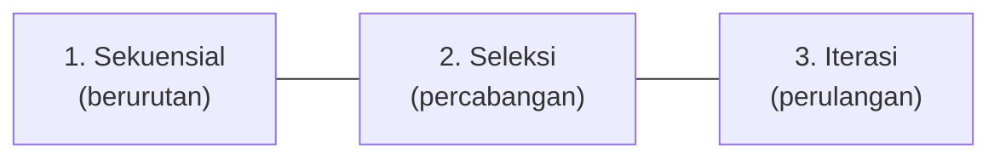
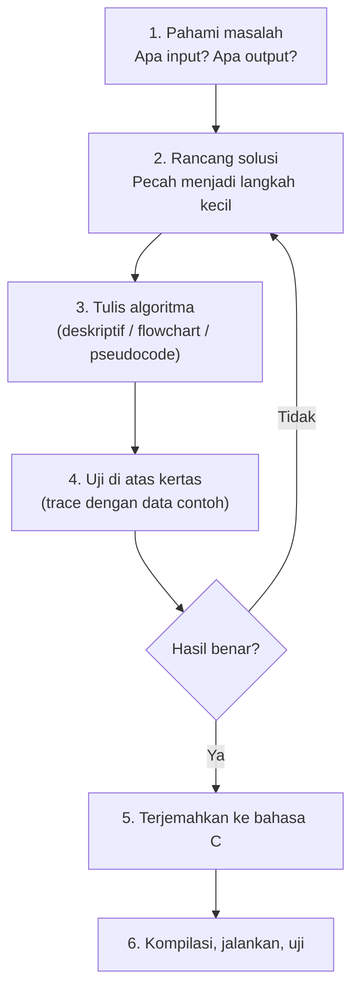
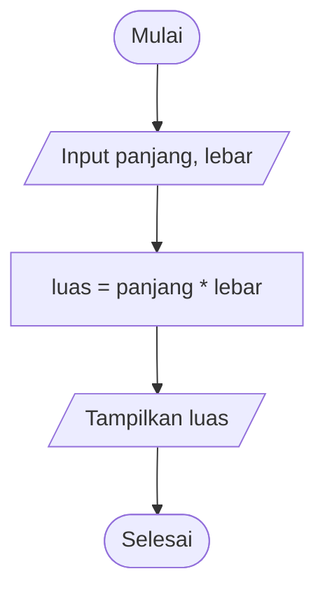
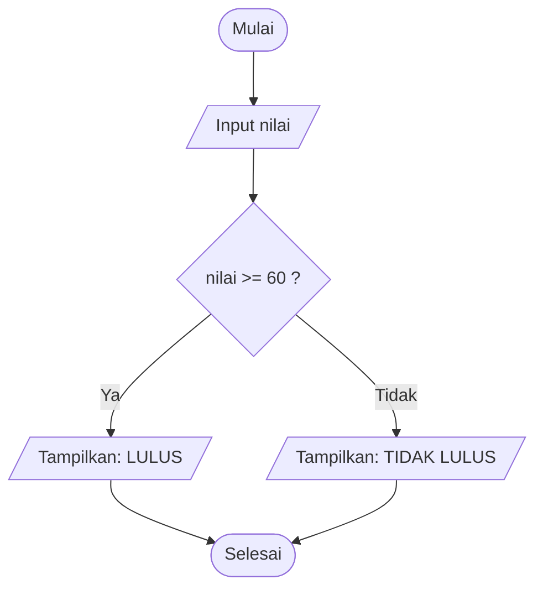
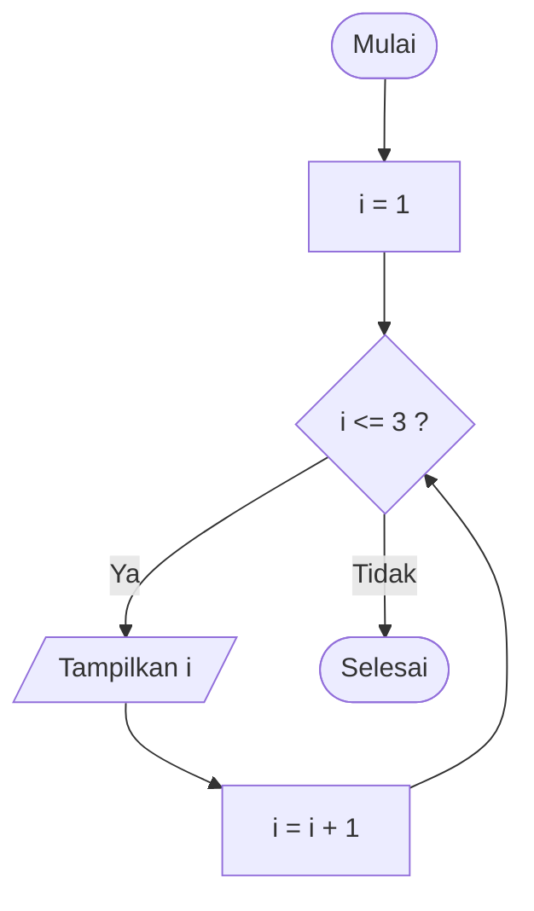
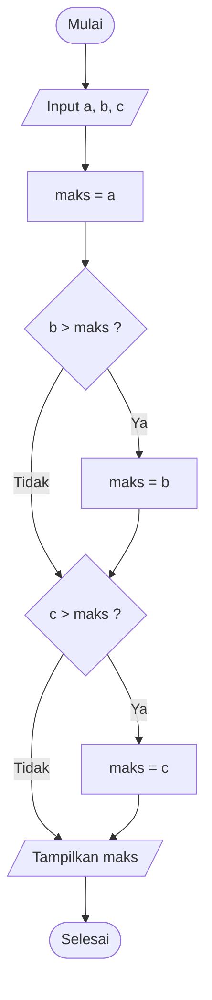
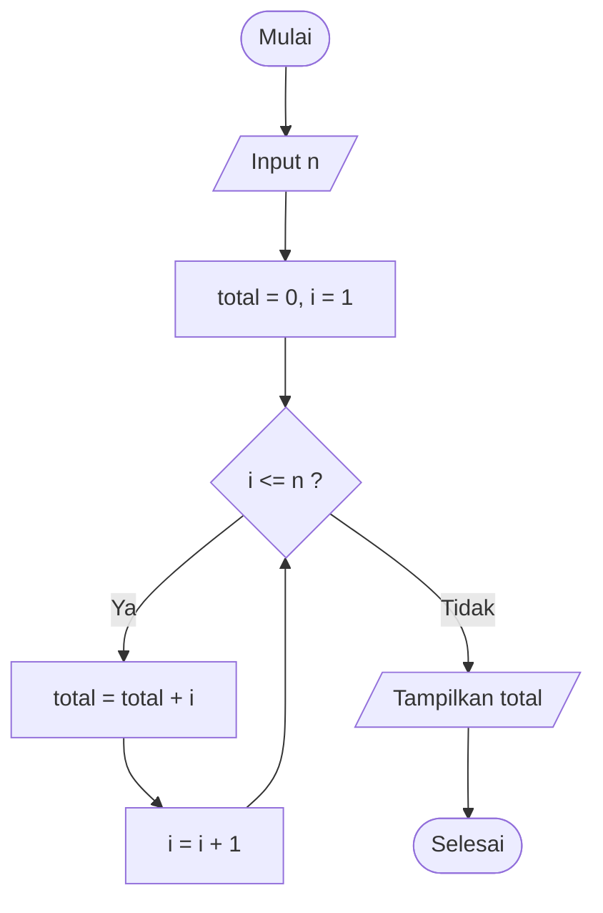

# 🧠 Modul 0: Pengenalan Algoritma, Flowchart, dan Pseudocode

<!-- ## Daftar Isi
1. [Apa Itu Algoritma?](#1-apa-itu-algoritma)
2. [Cara Menyusun Algoritma](#2-cara-menyusun-algoritma)
3. [Flowchart: Cara Mengenal dan Menulis](#3-flowchart-cara-mengenal-dan-menulis)
4. [Pseudocode: Cara Mengenal dan Menulis](#4-pseudocode-cara-mengenal-dan-menulis)
5. [Satu Masalah, Tiga Representasi, Satu Program C](#5-satu-masalah-tiga-representasi-satu-program-c)
6. [Contoh Kedua: Perulangan](#6-contoh-kedua-perulangan)
7. [Dari Pseudocode ke Bahasa C](#7-dari-pseudocode-ke-bahasa-c)
8. [Latihan](#8-latihan)

--- -->

## 1. Apa Itu Algoritma?

**Algoritma** adalah urutan langkah-langkah **logis, terbatas, dan sistematis** untuk menyelesaikan suatu masalah. Algoritma **tidak terikat bahasa pemrograman**: ia adalah "resep" yang kemudian diterjemahkan ke bahasa C, Python, Java, dan lainnya.

```
   MASALAH ──► ALGORITMA (resep) ──► PROGRAM (kode) ──► HASIL
   "Bikin teh"   1. Rebus air            #include...       Teh siap ☕
                 2. Masukkan teh
                 3. Tuang air
                 4. Aduk, sajikan
```

### 1.1 Ciri-ciri Algoritma yang Baik

| Ciri | Penjelasan | Contoh pelanggaran |
|------|------------|--------------------|
| **Input** | Punya nol atau lebih masukan | |
| **Output** | Menghasilkan minimal satu keluaran | Algoritma yang tidak menghasilkan apa pun |
| **Definit (jelas)** | Tiap langkah tidak ambigu | "Tambahkan garam secukupnya" |
| **Terbatas (finite)** | Pasti berhenti setelah sejumlah langkah | Perulangan tanpa henti |
| **Efektif** | Tiap langkah dapat dikerjakan | "Hitung bilangan prima terbesar" |

### 1.2 Tiga Struktur Dasar Algoritma

Seluruh algoritma, sebesar apa pun, tersusun dari **tiga struktur** ini:



```
 1. SEKUENSIAL           2. SELEKSI                 3. ITERASI
    (urut)                  (memilih)                  (mengulang)

    langkah A               ┌─ Ya ──► langkah X          ┌────────┐
       │                 ?──┤                            ▼        │
       ▼                    └─ Tidak ► langkah Y     ┌─ kondisi? ─┘ Ya
    langkah B                                        │ Tidak
       │                                             ▼
       ▼                                           lanjut
    langkah C
```

---

## 2. Cara Menyusun Algoritma

### 2.1 Tahapan Pemecahan Masalah



### 2.2 Tiga Cara Menuliskan Algoritma

| Cara | Bentuk | Kelebihan | Kekurangan |
|------|--------|-----------|------------|
| **Bahasa deskriptif** | Kalimat bernomor | Mudah dipahami siapa saja | Bisa ambigu, panjang |
| **Flowchart** | Diagram simbol dan panah | Alur terlihat visual | Sulit untuk algoritma besar |
| **Pseudocode** | Kode "palsu" mirip bahasa pemrograman | Dekat dengan kode asli | Perlu aturan konsisten |

### 2.3 Cara Menulis Algoritma Deskriptif

**Aturan penulisan:**
1. Beri **judul** algoritma.
2. Tulis **bagian masukan dan keluaran** lebih dulu.
3. Beri **nomor** tiap langkah, satu langkah = satu aksi.
4. Pakai **kata kerja perintah** (Baca, Hitung, Bandingkan, Tampilkan).
5. Langkah harus **jelas dan berurutan**; akhiri dengan "Selesai".

**Contoh: Menghitung Luas Persegi Panjang**

```
Judul   : Luas Persegi Panjang
Masukan : panjang, lebar
Keluaran: luas

1. Mulai
2. Baca nilai panjang
3. Baca nilai lebar
4. Hitung luas = panjang × lebar
5. Tampilkan luas
6. Selesai
```

---

## 3. Flowchart: Cara Mengenal dan Menulis

**Flowchart (diagram alir)** adalah gambar alur algoritma menggunakan **simbol standar** yang dihubungkan **panah**.

### 3.1 Simbol-simbol Flowchart

| Simbol | Nama | Fungsi | Sintaks Mermaid |
|:------:|------|--------|-----------------|
| ⬭ Oval/stadium | **Terminator** | Awal (*Mulai*) dan akhir (*Selesai*) | `A(["Mulai"])` |
| ▱ Jajar genjang | **Input/Output** | Membaca masukan atau menampilkan keluaran | `B[/"Input x"/]` |
| ▭ Persegi panjang | **Proses** | Perhitungan atau penugasan nilai | `C["x = a + b"]` |
| ◇ Belah ketupat | **Keputusan** | Pertanyaan dengan jawaban Ya/Tidak | `D{"x > 0 ?"}` |
| ▭▭ Persegi dengan garis ganda | **Subprogram** | Memanggil fungsi | `E[["hitung()"]]` |
| ➜ Panah | **Alur** | Arah jalannya algoritma | `A --> B` |
| ◯ Lingkaran kecil | **Konektor** | Menyambung alur yang terputus | `F((A))` |

```
  Tampilan simbol secara visual:

    ╭─────────╮      ╱───────────╱      ┌───────────┐      ╱╲
    │  Mulai  │     ╱  Input x  ╱       │ x = a + b │     ╱  ╲    Ya / Tidak
    ╰─────────╯    ╱───────────╱        └───────────┘    ╱ ?  ╲
    Terminator     Input/Output          Proses           ╲    ╱
                                                           ╲  ╱
                                                            ╲╱
                                                          Keputusan
```

### 3.2 Aturan Menulis Flowchart

1. Selalu **dimulai** dengan satu terminator `Mulai` dan **diakhiri** terminator `Selesai`.
2. Alur bergerak **dari atas ke bawah** (atau kiri ke kanan).
3. Setiap simbol berisi **satu aksi** dengan teks **singkat dan jelas**.
4. Tiap simbol (kecuali awal/akhir) punya **masuk dan keluar** panah.
5. Simbol **keputusan** punya **dua keluaran** berlabel `Ya` dan `Tidak`.
6. Panah **tidak boleh bersilangan** tanpa perlu; gunakan konektor bila rumit.
7. Pakai **simbol yang sesuai** (jangan memakai persegi untuk input).

### 3.3 Flowchart untuk Tiga Struktur Dasar

**a) Sekuensial**



**b) Seleksi**



**c) Iterasi**



### 3.4 Cara Menulis Flowchart dengan Mermaid

Semua diagram di modul ini ditulis dengan **teks**, jadi Anda dapat membuatnya sendiri.

````text
```mermaid
flowchart TD                 ← arah: TD (atas→bawah), LR (kiri→kanan)
    A(["Mulai"]) --> B[/"Input x"/]
    B --> C{"x > 0 ?"}
    C -- Ya --> D["Positif"]
    C -- Tidak --> E["Bukan positif"]
    D --> F(["Selesai"])
    E --> F
```
````

| Bagian | Arti |
|--------|------|
| `A`, `B`, `C` | ID unik tiap simbol |
| `([" "])` | bentuk terminator |
| `[/" "/]` | bentuk input/output |
| `[" "]` | bentuk proses |
| `{" "}` | bentuk keputusan |
| `-->` | panah penghubung |
| `-- Ya -->` | panah dengan label |

> 💡 Anda juga bisa menggambar flowchart dengan tangan, aplikasi draw.io, atau Lucidchart. Simbol dan aturannya sama.

---

## 4. Pseudocode: Cara Mengenal dan Menulis

**Pseudocode** adalah penulisan algoritma menggunakan **bahasa mirip kode program** tetapi **tidak terikat sintaks** bahasa tertentu. Tujuannya agar mudah dibaca manusia sekaligus mudah diterjemahkan ke kode.

### 4.1 Struktur Penulisan Pseudocode

Terdiri dari tiga bagian:

```
ALGORITMA NamaAlgoritma
{ Penjelasan singkat tujuan algoritma }

DEKLARASI                          ← bagian kamus: daftar variabel dan tipenya
    variabel1 : tipe
    variabel2 : tipe

DESKRIPSI                          ← bagian isi: langkah-langkah
    langkah 1
    langkah 2
    ...
```

> Komentar ditulis di antara `{ }` atau setelah `//`.

### 4.2 Aturan Penulisan Pseudocode

1. Gunakan **kata kunci huruf besar** (`INPUT`, `OUTPUT`, `IF`, `WHILE`) agar mudah dibedakan.
2. Gunakan **indentasi (menjorok)** untuk menunjukkan isi blok.
3. Setiap blok **harus ditutup** (`ENDIF`, `ENDWHILE`, `ENDFOR`).
4. Gunakan **nama variabel bermakna** (`luas`, bukan `x1`).
5. Penugasan ditulis dengan panah `←` (atau `:=`); perbandingan dengan `=`.
6. **Satu baris, satu aksi.**
7. Tidak memakai `;`, `{ }` blok, atau sintaks khas bahasa tertentu.

### 4.3 Daftar Kata Kunci dan Pasangannya di C

| Kebutuhan | Pseudocode | Bahasa C |
|-----------|------------|----------|
| Masukan | `INPUT x` | `scanf("%d", &x);` |
| Keluaran | `OUTPUT x` | `printf("%d", x);` |
| Penugasan | `x ← 5` | `x = 5;` |
| Seleksi 1 arah | `IF kondisi THEN ... ENDIF` | `if (kondisi) { ... }` |
| Seleksi 2 arah | `IF kondisi THEN ... ELSE ... ENDIF` | `if (...) {...} else {...}` |
| Seleksi banyak | `IF ... ELSE IF ... ELSE ... ENDIF` | `if ... else if ... else` |
| Pilih nilai | `CASE x OF ... ENDCASE` | `switch (x) { case ...}` |
| Perulangan pasti | `FOR i ← 1 TO n DO ... ENDFOR` | `for (i=1; i<=n; i++)` |
| Perulangan syarat awal | `WHILE kondisi DO ... ENDWHILE` | `while (kondisi) {...}` |
| Perulangan syarat akhir | `REPEAT ... UNTIL kondisi` | `do {...} while (!kondisi);` |
| Dan / Atau / Bukan | `AND`, `OR`, `NOT` | `&&`, `\|\|`, `!` |
| Sisa bagi | `a MOD b` | `a % b` |
| Bagi bulat | `a DIV b` | `a / b` (tipe int) |

> ⚠️ Perhatikan: `REPEAT ... UNTIL` berhenti ketika kondisi **benar**, sedangkan `do-while` di C berhenti ketika kondisi **salah**. Kondisinya perlu dibalik.

### 4.4 Tipe Data dalam Pseudocode

| Pseudocode | Arti | Padanan C |
|------------|------|-----------|
| `integer` | Bilangan bulat | `int` |
| `real` | Bilangan desimal | `float` / `double` |
| `char` | Satu karakter | `char` |
| `string` | Teks | `char[]` |
| `boolean` | Benar/Salah | `int` (0/1) atau `bool` |

### 4.5 Contoh Pseudocode Tiga Struktur Dasar

**a) Sekuensial: Luas Persegi Panjang**

```
ALGORITMA LuasPersegiPanjang
DEKLARASI
    panjang, lebar, luas : real
DESKRIPSI
    INPUT panjang
    INPUT lebar
    luas ← panjang * lebar
    OUTPUT luas
```

**b) Seleksi: Lulus atau Tidak**

```
ALGORITMA CekKelulusan
DEKLARASI
    nilai : integer
DESKRIPSI
    INPUT nilai
    IF nilai >= 60 THEN
        OUTPUT "LULUS"
    ELSE
        OUTPUT "TIDAK LULUS"
    ENDIF
```

**c) Iterasi: Cetak 1 sampai 3**

```
ALGORITMA CetakAngka
DEKLARASI
    i : integer
DESKRIPSI
    FOR i ← 1 TO 3 DO
        OUTPUT i
    ENDFOR
```

---

## 5. Satu Masalah, Tiga Representasi, Satu Program C

**Masalah:** *Tentukan bilangan terbesar dari tiga bilangan bulat.*

**Analisis:**
- Masukan: tiga bilangan `a`, `b`, `c`
- Keluaran: bilangan terbesar `maks`
- Strategi: anggap `a` terbesar dulu, lalu bandingkan dengan `b` dan `c`.

### 5.1 Representasi 1: Deskriptif

```
1. Mulai
2. Baca a, b, c
3. Anggap maks = a
4. Jika b > maks, maka maks = b
5. Jika c > maks, maka maks = c
6. Tampilkan maks
7. Selesai
```

### 5.2 Representasi 2: Flowchart



### 5.3 Representasi 3: Pseudocode

```
ALGORITMA TerbesarDariTiga
{ Menentukan bilangan terbesar dari tiga bilangan bulat }

DEKLARASI
    a, b, c, maks : integer

DESKRIPSI
    INPUT a, b, c
    maks ← a
    IF b > maks THEN
        maks ← b
    ENDIF
    IF c > maks THEN
        maks ← c
    ENDIF
    OUTPUT maks
```

### 5.4 Uji di Atas Kertas (Trace)

Data uji: `a = 7`, `b = 15`, `c = 9`

| Langkah | Aksi | `maks` |
|---------|------|--------|
| 1 | `maks ← a` | 7 |
| 2 | `15 > 7`? Ya → `maks ← 15` | 15 |
| 3 | `9 > 15`? Tidak → tidak berubah | 15 |
| 4 | `OUTPUT maks` | **15** ✔ |

### 5.5 Implementasi dalam Bahasa C

```c
#include <stdio.h>

int main() {
    int a, b, c, maks;

    printf("Masukkan tiga bilangan: ");
    scanf("%d %d %d", &a, &b, &c);

    maks = a;
    if (b > maks) {
        maks = b;
    }
    if (c > maks) {
        maks = c;
    }

    printf("Bilangan terbesar = %d\n", maks);
    return 0;
}
```

**Hasil (Output):**

```
Masukkan tiga bilangan: 7 15 9
Bilangan terbesar = 15
```

> 🔑 Perhatikan: struktur pseudocode, flowchart, dan kode C **sama persis**, hanya berbeda cara penulisannya.

---

## 6. Contoh Kedua: Perulangan

**Masalah:** *Hitung jumlah bilangan dari 1 sampai N.*

### 6.1 Pseudocode

```
ALGORITMA JumlahDeret
DEKLARASI
    n, i, total : integer
DESKRIPSI
    INPUT n
    total ← 0
    FOR i ← 1 TO n DO
        total ← total + i
    ENDFOR
    OUTPUT total
```

### 6.2 Flowchart



### 6.3 Trace untuk `n = 5`

| Putaran | `i` | `total` sebelum | `total` sesudah |
|---------|-----|-----------------|-----------------|
| 1 | 1 | 0 | 1 |
| 2 | 2 | 1 | 3 |
| 3 | 3 | 3 | 6 |
| 4 | 4 | 6 | 10 |
| 5 | 5 | 10 | 15 |
| Berhenti | 6 | `6 <= 5` salah | **15** |

### 6.4 Kode C

```c
#include <stdio.h>

int main() {
    int n, i, total;

    printf("Masukkan n: ");
    scanf("%d", &n);

    total = 0;
    for (i = 1; i <= n; i++) {
        total = total + i;
    }

    printf("Jumlah 1 sampai %d = %d\n", n, total);
    return 0;
}
```

**Hasil (Output):**

```
Masukkan n: 5
Jumlah 1 sampai 5 = 15
```

---

## 7. Dari Pseudocode ke Bahasa C

Pola penerjemahan agar tidak bingung:

```
   PSEUDOCODE                          BAHASA C
 ┌──────────────────────────┐      ┌─────────────────────────────────┐
 │ ALGORITMA Nama           │ ───► │ #include <stdio.h>              │
 │ DEKLARASI                │      │ int main() {                    │
 │    a, b : integer        │ ───► │     int a, b;                   │
 │ DESKRIPSI                │      │                                 │
 │    INPUT a               │ ───► │     scanf("%d", &a);            │
 │    b ← a * 2             │ ───► │     b = a * 2;                  │
 │    OUTPUT b              │ ───► │     printf("%d\n", b);          │
 │                          │      │     return 0;                   │
 │                          │      │ }                               │
 └──────────────────────────┘      └─────────────────────────────────┘
```

**Langkah menerjemahkan:**
1. Bagian `DEKLARASI` → deklarasi variabel di awal `main()`, ganti tipe (`integer`→`int`, `real`→`float`).
2. `INPUT` → `scanf` (ingat `&`) dan beri `printf` sebagai petunjuk bila perlu.
3. `OUTPUT` → `printf` dengan format sesuai tipe.
4. `←` → `=`.
5. `ENDIF/ENDWHILE/ENDFOR` → tutup dengan `}`.
6. Tambahkan `#include <stdio.h>`, `int main()`, dan `return 0;`.

---

## 8. Latihan

1. Tulis algoritma **deskriptif**, **pseudocode**, dan **flowchart** untuk menghitung **luas segitiga** (alas dan tinggi dibaca dari pengguna).
2. Buat pseudocode dan flowchart untuk menentukan sebuah bilangan **ganjil atau genap** (petunjuk: `n MOD 2`).
3. Buat pseudocode untuk menampilkan bilangan **1 sampai 10** dengan `WHILE`.
4. Perhatikan pseudocode berikut, lakukan trace untuk `n = 4`, lalu tuliskan hasil akhirnya:
   ```
   INPUT n
   hasil ← 1
   FOR i ← 1 TO n DO
       hasil ← hasil * i
   ENDFOR
   OUTPUT hasil
   ```
5. Terjemahkan jawaban nomor 2 ke dalam bahasa C dan jalankan.

### ❗ Kesalahan Umum

| Kesalahan | Penjelasan | Perbaikan |
|-----------|------------|-----------|
| Langkah ambigu | "Hitung hasilnya" tanpa rumus | Tulis rumus jelas |
| Flowchart tanpa `Mulai`/`Selesai` | Alur tidak lengkap | Selalu beri terminator |
| Keputusan hanya satu keluaran | Cabang tidak lengkap | Beri jalur `Ya` dan `Tidak` |
| Lupa menutup blok (`ENDIF`) | Struktur tidak jelas | Pasangkan setiap pembuka dengan penutup |
| Perulangan tanpa perubahan variabel | Tak pernah berhenti | Pastikan kondisi bisa menjadi salah |
| Menulis sintaks bahasa C pada pseudocode | Menyalahi tujuan pseudocode | Gunakan kata kunci umum (`INPUT`, `IF-THEN`) |
| Tidak menguji dengan trace | Kesalahan logika lolos | Uji dengan data contoh sebelum membuat kode |

---

🏠 [Daftar Isi](README.md) | ➡️ [Modul 1: Fondasi Bahasa C](Modul-1-Fondasi-Bahasa-C.md)
