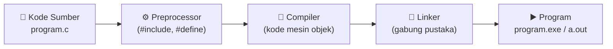
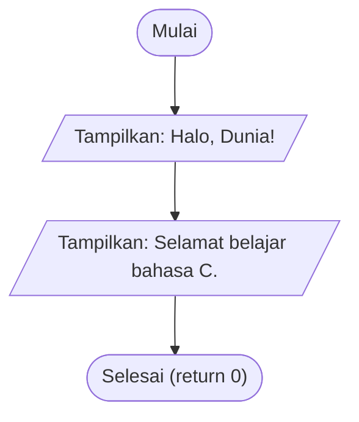
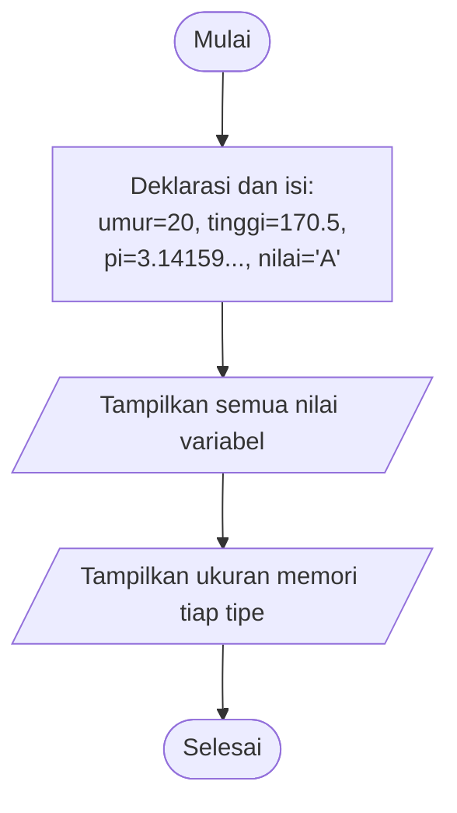
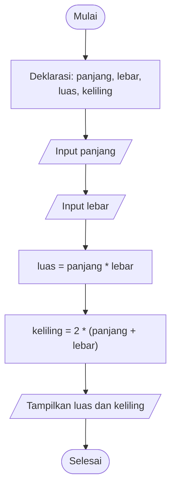
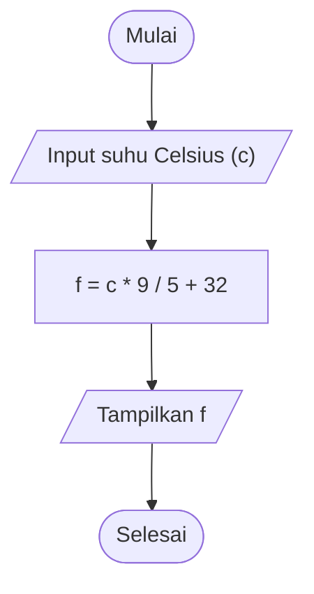

# 🧱 Modul 1: Fondasi Bahasa C

<!-- ## Daftar Isi
1. [Pengantar: Dari Kode ke Program](#1-pengantar-dari-kode-ke-program)
2. [Struktur Kode Utama](#2-struktur-kode-utama)
3. [Tipe Data Utama](#3-tipe-data-utama)
4. [Input/Output](#4-inputoutput)
5. [Operator](#5-operator)
6. [Latihan](#6-latihan)

---s -->

## 1. Pengantar: Dari Kode ke Program

Bahasa C adalah bahasa **terkompilasi**: kode sumber (`.c`) diterjemahkan oleh *compiler* menjadi program yang dapat dijalankan komputer.



---

## 2. Struktur Kode Utama

### 2.1 Anatomi Program C

```
  #include <stdio.h>        ◄── (1) Memanggil pustaka standar Input/Output
                                
  int main() {              ◄── (2) Titik awal eksekusi program
                                
      printf("Halo!\n");    ◄── (3) Pernyataan (statement), diakhiri titik koma ;
                                
      return 0;             ◄── (4) Program selesai TANPA error (0 = sukses)
  }                         ◄── (5) Akhir blok fungsi main
```

| Elemen | Fungsi |
|--------|--------|
| `#include <stdio.h>` | Menyertakan pustaka *Standard Input Output* agar `printf()` dan `scanf()` dapat dipakai |
| `int main()` | Fungsi utama. Eksekusi **selalu** dimulai dari sini. `int` berarti fungsi mengembalikan bilangan bulat |
| `{ ... }` | Kurung kurawal menandai awal dan akhir blok kode |
| `return 0;` | Mengembalikan nilai 0 ke sistem operasi: program berakhir normal |
| `;` | Penutup setiap pernyataan |
| `//` atau `/* */` | Komentar (diabaikan compiler) |

### 2.2 Flowchart Program Dasar



### 2.3 Program 1.1: Hello World

```c
#include <stdio.h>

int main() {
    // Menampilkan teks ke layar
    printf("Halo, Dunia!\n");
    printf("Selamat belajar bahasa C.\n");
    return 0;
}
```

**Hasil (Output):**

```
Halo, Dunia!
Selamat belajar bahasa C.
```

> 📌 `\n` adalah *escape sequence* untuk baris baru (*new line*).

---

## 3. Tipe Data Utama

### 3.1 Ilustrasi "Kotak Penyimpanan"

Variabel ibarat kotak berlabel. Tipe data menentukan **jenis isi** dan **ukuran kotak**.

```
 ┌─────────┐   ┌─────────┐   ┌─────────────────┐   ┌───┐
 │   20    │   │  170.5  │   │ 3.14159265358979│   │ A │
 └─────────┘   └─────────┘   └─────────────────┘   └───┘
   int umur     float tinggi    double pi          char nilai
   (4 byte)     (4 byte)        (8 byte)           (1 byte)
```

### 3.2 Tabel Tipe Data

| Tipe | Kegunaan | Ukuran umum | Format `printf` | Contoh nilai |
|------|----------|-------------|-----------------|--------------|
| `int` | Bilangan bulat | 4 byte | `%d` | `20`, `-7`, `0` |
| `float` | Desimal presisi tunggal (±6–7 digit) | 4 byte | `%f` | `170.5f` |
| `double` | Desimal presisi ganda (±15 digit) | 8 byte | `%lf` (scanf), `%f` / `%lf` (printf) | `3.14159265` |
| `char` | Satu karakter (disimpan sebagai kode ASCII) | 1 byte | `%c` | `'A'` |

### 3.3 Flowchart Deklarasi dan Tampil Data



### 3.4 Program 1.2: Mengenal Tipe Data

```c
#include <stdio.h>

int main() {
    int    umur   = 20;
    float  tinggi = 170.5f;
    double pi     = 3.141592653589793;
    char   nilai  = 'A';

    printf("umur   = %d\n", umur);
    printf("tinggi = %.1f cm\n", tinggi);
    printf("pi     = %.10f\n", pi);
    printf("nilai  = %c (kode ASCII %d)\n", nilai, nilai);

    printf("\n--- Ukuran memori ---\n");
    printf("int    : %zu byte\n", sizeof(int));
    printf("float  : %zu byte\n", sizeof(float));
    printf("double : %zu byte\n", sizeof(double));
    printf("char   : %zu byte\n", sizeof(char));
    return 0;
}
```

**Hasil (Output):**

```
umur   = 20
tinggi = 170.5 cm
pi     = 3.1415926536
nilai  = A (kode ASCII 65)

--- Ukuran memori ---
int    : 4 byte
float  : 4 byte
double : 8 byte
char   : 1 byte
```

> 📌 `%.2f` berarti tampilkan 2 angka di belakang koma. Karakter `'A'` dicetak sebagai angka `65` bila memakai `%d`.

---

## 4. Input/Output

### 4.1 `printf()`: Keluaran

```c
printf("format", argumen1, argumen2, ...);
```

| Spesifier | Tipe |  | Escape | Arti |
|-----------|------|--|--------|------|
| `%d` | int | | `\n` | baris baru |
| `%f` | float/double | | `\t` | tab |
| `%c` | char | | `\\` | karakter `\` |
| `%s` | string | | `\"` | tanda kutip |
| `%.2f` | desimal 2 digit | | `%%` | karakter `%` |

### 4.2 `scanf()`: Masukan

```c
scanf("format", &variabel);
```

> ⚠️ **Wajib** memakai operator `&` (alamat variabel) pada `scanf` untuk tipe `int`, `float`, `double`, dan `char`.

```
   Papan ketik ──► scanf("%f", &panjang) ──► tersimpan di variabel "panjang"
                                              (di alamat memori &panjang)
```

### 4.3 Flowchart: Luas dan Keliling Persegi Panjang



### 4.4 Program 1.3: Luas dan Keliling

```c
#include <stdio.h>

int main() {
    float panjang, lebar, luas, keliling;

    printf("Masukkan panjang: ");
    scanf("%f", &panjang);
    printf("Masukkan lebar  : ");
    scanf("%f", &lebar);

    luas     = panjang * lebar;
    keliling = 2 * (panjang + lebar);

    printf("\nLuas     = %.2f\n", luas);
    printf("Keliling = %.2f\n", keliling);
    return 0;
}
```

**Hasil (Output)** (masukan pengguna: `8` dan `5.5`):

```
Masukkan panjang: 8
Masukkan lebar  : 5.5

Luas     = 44.00
Keliling = 27.00
```

---

## 5. Operator

### 5.1 Operator Aritmatika

| Operator | Arti | Contoh (`a=17`, `b=5`) | Hasil |
|----------|------|------------------------|-------|
| `+` | Penjumlahan | `a + b` | 22 |
| `-` | Pengurangan | `a - b` | 12 |
| `*` | Perkalian | `a * b` | 85 |
| `/` | Pembagian | `a / b` | **3** (bulat, sisa dibuang) |
| `%` | Modulus (sisa bagi) | `a % b` | 2 |

> ⚠️ Pembagian dua `int` menghasilkan `int`. Untuk hasil desimal, ubah salah satu menjadi float: `a / (float)b` → `3.40`.

### 5.2 Operator Relasional (hasil: `1` = benar, `0` = salah)

| Operator | Arti | Contoh (`a=17`, `b=5`) | Hasil |
|----------|------|------------------------|-------|
| `==` | sama dengan | `a == b` | 0 |
| `!=` | tidak sama dengan | `a != b` | 1 |
| `>` | lebih besar | `a > b` | 1 |
| `<` | lebih kecil | `a < b` | 0 |

> 🚫 Jangan tertukar: `=` adalah **penugasan** (assignment), `==` adalah **perbandingan**.

### 5.3 Operator Logika

| Operator | Nama | Aturan |
|----------|------|--------|
| `&&` | AND | Benar jika **kedua** sisi benar |
| `\|\|` | OR | Benar jika **salah satu** sisi benar |
| `!` | NOT | Membalik nilai kebenaran |

**Tabel Kebenaran:**

| A | B | `A && B` | `A \|\| B` | `!A` |
|---|---|----------|------------|------|
| 1 | 1 | 1 | 1 | 0 |
| 1 | 0 | 0 | 1 | 0 |
| 0 | 1 | 0 | 1 | 1 |
| 0 | 0 | 0 | 0 | 1 |

### 5.4 Urutan Prioritas (tinggi ke rendah)

```
 1. ( )              kurung
 2. !                NOT
 3. *  /  %          perkalian, pembagian, modulus
 4. +  -             tambah, kurang
 5. <  >             relasional
 6. == !=            kesamaan
 7. &&               AND
 8. ||               OR
 9. =                penugasan
```

### 5.5 Program 1.4: Demonstrasi Operator

```c
#include <stdio.h>

int main() {
    int a = 17, b = 5;
    int umur = 20, punyaSIM = 1;

    printf("=== Aritmatika ===\n");
    printf("a + b         = %d\n", a + b);
    printf("a - b         = %d\n", a - b);
    printf("a * b         = %d\n", a * b);
    printf("a / b         = %d\n", a / b);
    printf("a %% b         = %d\n", a % b);
    printf("a / (float)b  = %.2f\n", a / (float)b);

    printf("\n=== Relasional ===\n");
    printf("a == b = %d\n", a == b);
    printf("a != b = %d\n", a != b);
    printf("a >  b = %d\n", a > b);
    printf("a <  b = %d\n", a < b);

    printf("\n=== Logika ===\n");
    printf("(a>5) && (b>10) = %d\n", (a > 5) && (b > 10));
    printf("(a>5) || (b>10) = %d\n", (a > 5) || (b > 10));
    printf("!(a>5)          = %d\n", !(a > 5));
    printf("Boleh berkendara (umur>=17 && punya SIM)? %d\n",
           umur >= 17 && punyaSIM);
    return 0;
}
```

**Hasil (Output):**

```
=== Aritmatika ===
a + b         = 22
a - b         = 12
a * b         = 85
a / b         = 3
a % b         = 2
a / (float)b  = 3.40

=== Relasional ===
a == b = 0
a != b = 1
a >  b = 1
a <  b = 0

=== Logika ===
(a>5) && (b>10) = 0
(a>5) || (b>10) = 1
!(a>5)          = 0
Boleh berkendara (umur>=17 && punya SIM)? 1
```

### 5.6 Flowchart: Konversi Suhu Celsius → Fahrenheit



### 5.7 Program 1.5: Konversi Suhu

```c
#include <stdio.h>

int main() {
    float celsius, fahrenheit;

    printf("Masukkan suhu (Celsius): ");
    scanf("%f", &celsius);

    fahrenheit = celsius * 9 / 5 + 32;

    printf("%.1f derajat C = %.2f derajat F\n", celsius, fahrenheit);
    return 0;
}
```

**Hasil (Output)** (masukan: `37.5`):

```
Masukkan suhu (Celsius): 37.5
37.5 derajat C = 99.50 derajat F
```

---

## 6. Latihan

1. Buat program yang membaca **jari-jari** lingkaran lalu menampilkan luas (`3.14159 × r²`) dan kelilingnya.
2. Buat program yang membaca bilangan bulat `a` dan `b`, lalu tampilkan hasil bagi bulat, sisa bagi, dan hasil bagi desimal.
3. Buat program yang menanyakan sebuah **karakter** lalu menampilkan kode ASCII-nya.
4. Tulis ekspresi logika yang bernilai benar bila seseorang berumur 17–60 tahun.

### ❗ Kesalahan Umum Pemula

| Kesalahan | Akibat | Perbaikan |
|-----------|--------|-----------|
| Lupa `;` | *Compile error* | Akhiri statement dengan `;` |
| `scanf("%d", x)` tanpa `&` | Program crash | `scanf("%d", &x)` |
| `if (a = 5)` | Selalu benar, nilai `a` berubah | `if (a == 5)` |
| `5 / 2` ingin hasil `2.5` | Hasil `2` | `5 / 2.0` |
| Format tidak cocok (`%d` untuk float) | Output ngawur | Samakan format dengan tipe data |

---

⬅️ [Modul 0: Algoritma, Flowchart, Pseudocode](Modul-0-Algoritma-Flowchart-Pseudocode.md) | 🏠 [Daftar Isi](/bahasa-c/Modul-0-Algoritma-Flowchart-Pseudocode) | ➡️ [Modul 2: Kontrol Alur Logika](Modul-2-Kontrol-Alur-Logika.md)
