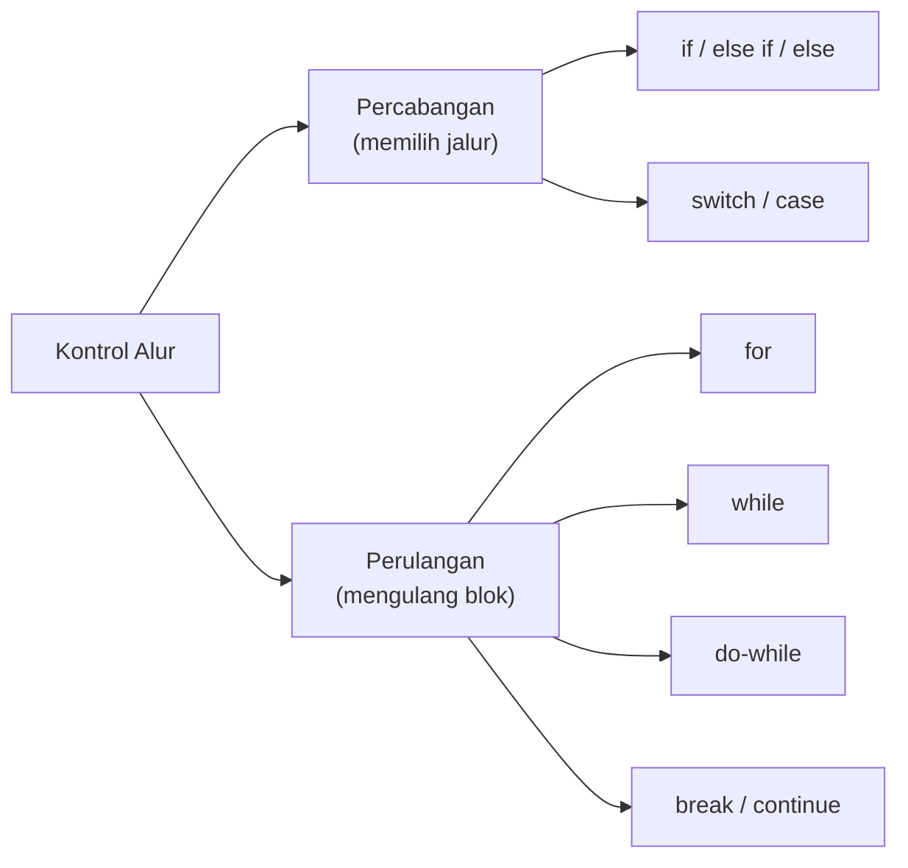
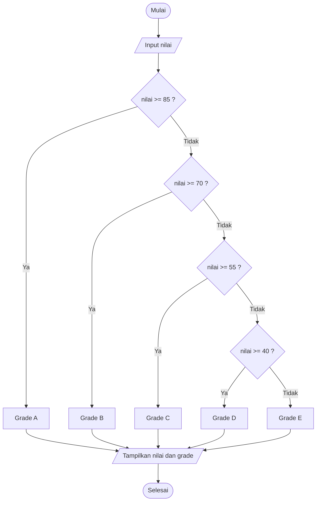
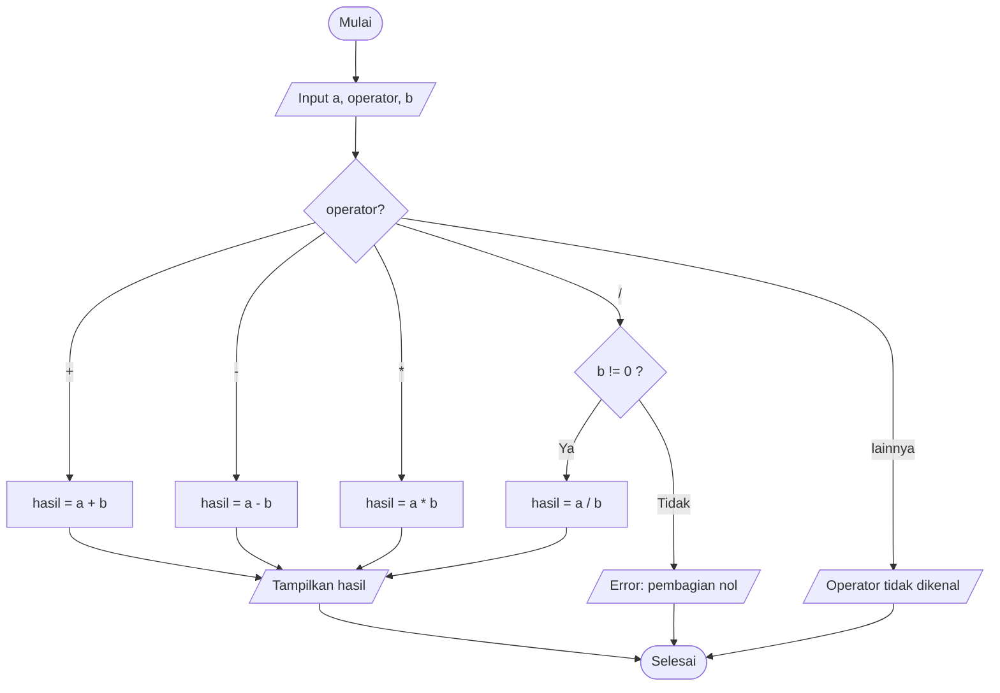
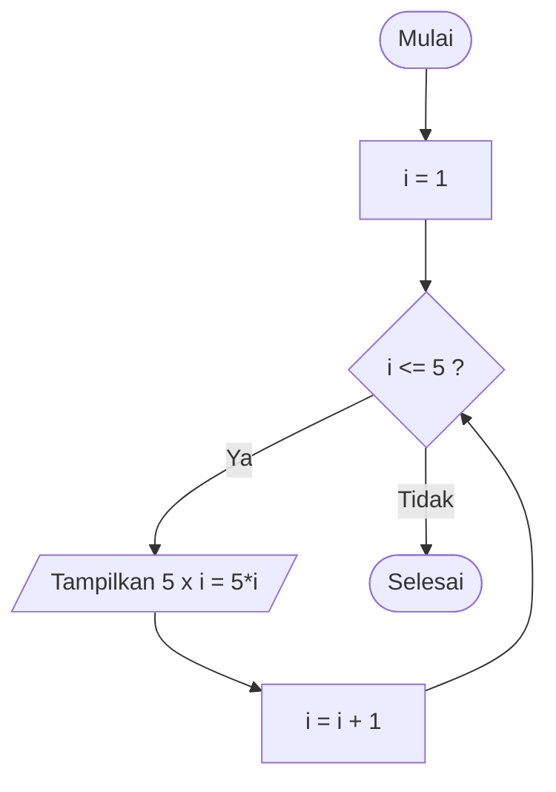
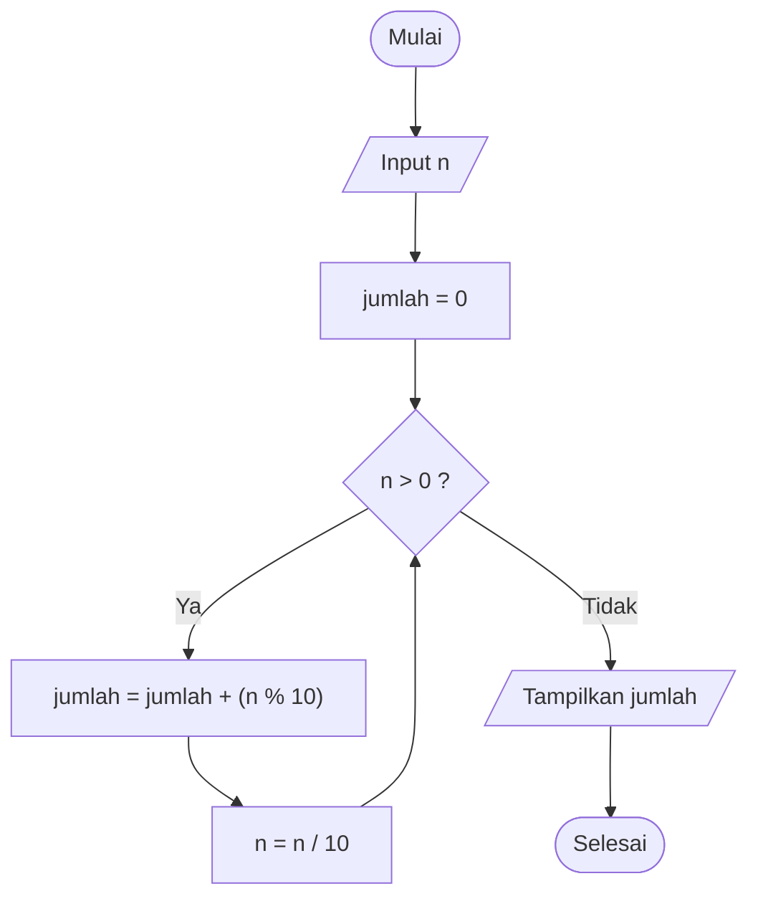
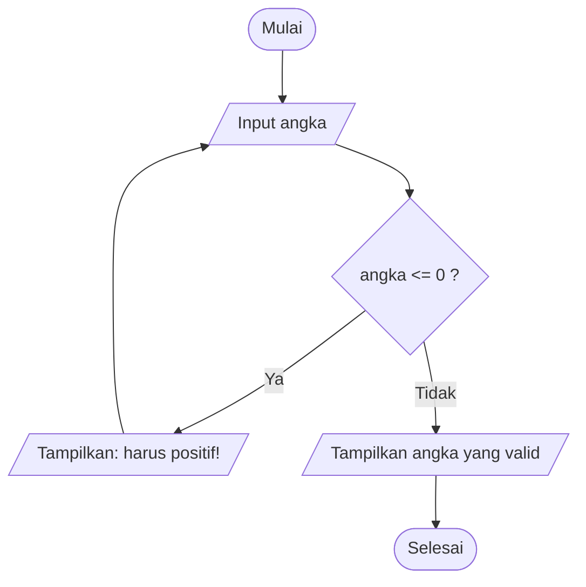
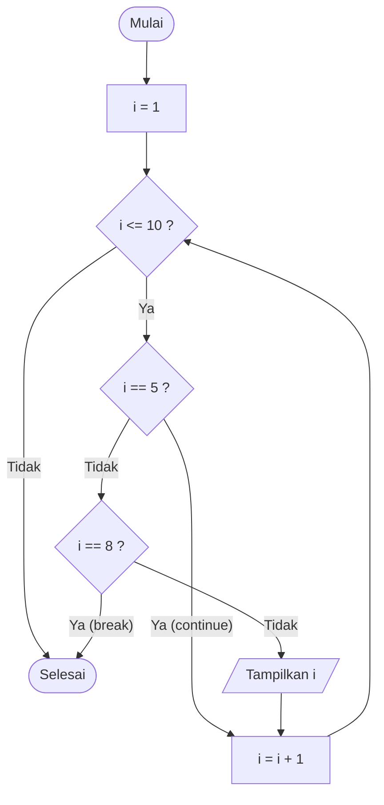

# 🔀 Modul 2: Kontrol Alur Logika

<!-- ## Daftar Isi
1. [Gambaran Umum](#1-gambaran-umum)
2. [Percabangan `if - else if - else`](#2-percabangan-if---else-if---else)
3. [Percabangan `switch - case`](#3-percabangan-switch---case)
4. [Perulangan `for`](#4-perulangan-for)
5. [Perulangan `while`](#5-perulangan-while)
6. [Perulangan `do-while`](#6-perulangan-do-while)
7. [`break` dan `continue`](#7-break-dan-continue)
8. [Perulangan Bersarang](#8-perulangan-bersarang-nested-loop)
9. [Latihan](#9-latihan)

--- -->

## 1. Gambaran Umum

Program tidak selalu berjalan lurus dari atas ke bawah. **Kontrol alur** mengatur *kapan* dan *berapa kali* sebuah blok kode dijalankan.



```
  Persimpangan jalan (percabangan)         Putaran (perulangan)

          ┌──► jalur A                         ┌────────┐
   ?──────┤                                    ▼        │
          └──► jalur B                      [ kerjakan ]─┘ selama kondisi benar
```

---

## 2. Percabangan `if - else if - else`

### 2.1 Sintaks

```c
if (kondisi1) {
    // dijalankan bila kondisi1 benar
} else if (kondisi2) {
    // dijalankan bila kondisi1 salah dan kondisi2 benar
} else {
    // dijalankan bila semua kondisi salah
}
```

> Kondisi dievaluasi **berurutan dari atas**. Begitu ada satu yang benar, sisanya dilewati.

### 2.2 Flowchart: Penentuan Grade Nilai

Aturan: ≥85 = A, ≥70 = B, ≥55 = C, ≥40 = D, selainnya E.



### 2.3 Program 2.1: Grade Nilai

```c
#include <stdio.h>

int main() {
    int nilai;
    char grade;
    const char *ket;

    printf("Masukkan nilai (0-100): ");
    scanf("%d", &nilai);

    if (nilai < 0 || nilai > 100) {
        printf("Nilai tidak valid!\n");
        return 1;
    }

    if (nilai >= 85) {
        grade = 'A'; ket = "Sangat Baik";
    } else if (nilai >= 70) {
        grade = 'B'; ket = "Baik";
    } else if (nilai >= 55) {
        grade = 'C'; ket = "Cukup";
    } else if (nilai >= 40) {
        grade = 'D'; ket = "Kurang";
    } else {
        grade = 'E'; ket = "Sangat Kurang";
    }

    printf("Nilai %d -> Grade %c (%s)\n", nilai, grade, ket);
    return 0;
}
```

**Hasil (Output)** — dua kali percobaan:

```
Masukkan nilai (0-100): 78
Nilai 78 -> Grade B (Baik)
```

```
Masukkan nilai (0-100): 120
Nilai tidak valid!
```

---

## 3. Percabangan `switch - case`

Cocok bila satu variabel dibandingkan dengan **nilai diskrit** (bulat atau karakter).

### 3.1 Sintaks

```c
switch (ekspresi) {
    case nilai1:
        // aksi 1
        break;
    case nilai2:
        // aksi 2
        break;
    default:
        // bila tidak ada yang cocok
}
```

> ⚠️ Tanpa `break`, eksekusi **"jatuh" (fall-through)** ke case berikutnya.

### 3.2 Flowchart: Kalkulator Sederhana



### 3.3 Program 2.2: Kalkulator

```c
#include <stdio.h>

int main() {
    double a, b;
    char op;

    printf("Masukkan ekspresi (contoh: 12 * 4): ");
    scanf("%lf %c %lf", &a, &op, &b);

    switch (op) {
        case '+':
            printf("%.2f + %.2f = %.2f\n", a, b, a + b);
            break;
        case '-':
            printf("%.2f - %.2f = %.2f\n", a, b, a - b);
            break;
        case '*':
            printf("%.2f * %.2f = %.2f\n", a, b, a * b);
            break;
        case '/':
            if (b != 0)
                printf("%.2f / %.2f = %.2f\n", a, b, a / b);
            else
                printf("Error: pembagian dengan nol!\n");
            break;
        default:
            printf("Operator '%c' tidak dikenal.\n", op);
    }
    return 0;
}
```

**Hasil (Output):**

```
Masukkan ekspresi (contoh: 12 * 4): 12 * 4
12.00 * 4.00 = 48.00
```

```
Masukkan ekspresi (contoh: 12 * 4): 9 / 0
Error: pembagian dengan nol!
```

### 3.4 Program 2.3: Memanfaatkan *Fall-through*

Beberapa case sengaja digabung (tanpa `break`) untuk aksi yang sama.

```c
#include <stdio.h>

int main() {
    int hari;
    printf("Masukkan nomor hari (1=Senin ... 7=Minggu): ");
    scanf("%d", &hari);

    switch (hari) {
        case 1: case 2: case 3: case 4: case 5:
            printf("Hari kerja\n");
            break;
        case 6:
        case 7:
            printf("Akhir pekan\n");
            break;
        default:
            printf("Nomor hari tidak valid\n");
    }
    return 0;
}
```

**Hasil (Output)** (masukan `6`):

```
Masukkan nomor hari (1=Senin ... 7=Minggu): 6
Akhir pekan
```

### 3.5 `if-else` vs `switch`

| Aspek | `if - else if` | `switch - case` |
|-------|----------------|-----------------|
| Jenis kondisi | Rentang, ekspresi logika kompleks | Nilai tunggal diskrit (int/char) |
| Contoh cocok | `nilai >= 70` | menu `1,2,3`, operator `+ - * /` |
| Tipe `float` | Bisa | **Tidak** bisa |

---

## 4. Perulangan `for`

Dipakai ketika **jumlah iterasi sudah diketahui**.

```c
for (inisialisasi; kondisi; perubahan) {
    // badan perulangan
}
```

```
   for ( int i = 1 ;  i <= 5 ;  i++ )
         └──(1)──┘  └─(2)──┘  └(4)┘
   (1) Inisialisasi dijalankan sekali
   (2) Kondisi dicek tiap putaran
   (3) Badan perulangan dijalankan jika kondisi benar
   (4) Perubahan (i++) lalu kembali ke (2)
```

### 4.1 Flowchart



### 4.2 Program 2.4: Tabel Perkalian dan Jumlah Deret

```c
#include <stdio.h>

int main() {
    printf("Tabel perkalian 5:\n");
    for (int i = 1; i <= 5; i++) {
        printf("5 x %d = %d\n", i, 5 * i);
    }

    int total = 0;
    for (int i = 1; i <= 10; i++) {
        total += i;            // total = total + i
    }
    printf("\nJumlah 1 sampai 10 = %d\n", total);
    return 0;
}
```

**Hasil (Output):**

```
Tabel perkalian 5:
5 x 1 = 5
5 x 2 = 10
5 x 3 = 15
5 x 4 = 20
5 x 5 = 25

Jumlah 1 sampai 10 = 55
```

---

## 5. Perulangan `while`

Kondisi diperiksa **di awal**. Jika sejak awal salah, badan perulangan **tidak pernah** dijalankan.

```c
while (kondisi) {
    // badan perulangan
}
```

### 5.1 Flowchart: Menjumlahkan Digit Bilangan



### 5.2 Program 2.5: Jumlah Digit

```c
#include <stdio.h>

int main() {
    int n, asli, jumlah = 0;

    printf("Masukkan bilangan bulat positif: ");
    scanf("%d", &n);
    asli = n;

    while (n > 0) {
        jumlah += n % 10;   // ambil digit terakhir
        n /= 10;            // buang digit terakhir
    }

    printf("Jumlah digit dari %d = %d\n", asli, jumlah);
    return 0;
}
```

**Hasil (Output)** (masukan `2458`):

```
Masukkan bilangan bulat positif: 2458
Jumlah digit dari 2458 = 19
```

**Tabel penelusuran (trace):**

| Putaran | `n` sebelum | `n % 10` | `jumlah` | `n` sesudah (`n/10`) |
|---------|-------------|----------|----------|----------------------|
| 1 | 2458 | 8 | 8 | 245 |
| 2 | 245 | 5 | 13 | 24 |
| 3 | 24 | 4 | 17 | 2 |
| 4 | 2 | 2 | 19 | 0 → berhenti |

---

## 6. Perulangan `do-while`

Badan perulangan dijalankan **minimal satu kali**, kondisi diperiksa **di akhir**. Cocok untuk validasi input dan menu.

```c
do {
    // badan perulangan
} while (kondisi);      // <-- perhatikan titik koma
```

### 6.1 Flowchart: Validasi Input Bilangan Positif



### 6.2 Program 2.6: Validasi Input

```c
#include <stdio.h>

int main() {
    int angka;

    do {
        printf("Masukkan bilangan positif: ");
        scanf("%d", &angka);
        if (angka <= 0) {
            printf("  -> Harus lebih dari 0, coba lagi.\n");
        }
    } while (angka <= 0);

    printf("Anda memasukkan %d\n", angka);
    return 0;
}
```

**Hasil (Output)** (masukan `-5`, `0`, lalu `12`):

```
Masukkan bilangan positif: -5
  -> Harus lebih dari 0, coba lagi.
Masukkan bilangan positif: 0
  -> Harus lebih dari 0, coba lagi.
Masukkan bilangan positif: 12
Anda memasukkan 12
```

### 6.3 Perbandingan Ketiga Perulangan

| | `for` | `while` | `do-while` |
|---|-------|---------|------------|
| Cek kondisi | Di awal | Di awal | **Di akhir** |
| Minimal dijalankan | 0 kali | 0 kali | **1 kali** |
| Cocok untuk | Jumlah iterasi pasti | Iterasi bergantung kondisi | Menu / validasi input |

---

## 7. `break` dan `continue`

| Pernyataan | Efek |
|------------|------|
| `break` | **Keluar total** dari perulangan |
| `continue` | **Lompati** sisa iterasi saat ini, lanjut ke iterasi berikutnya |

### 7.1 Flowchart



### 7.2 Program 2.7

```c
#include <stdio.h>

int main() {
    for (int i = 1; i <= 10; i++) {
        if (i == 5) continue;   // lewati angka 5
        if (i == 8) break;      // berhenti saat mencapai 8
        printf("%d ", i);
    }
    printf("\nPerulangan selesai.\n");
    return 0;
}
```

**Hasil (Output):**

```
1 2 3 4 6 7 
Perulangan selesai.
```

---

## 8. Perulangan Bersarang (Nested Loop)

Perulangan di dalam perulangan. Putaran luar = **baris**, putaran dalam = **kolom**.

### 8.1 Program 2.8: Pola Segitiga Bintang

```c
#include <stdio.h>

int main() {
    int tinggi = 4;
    for (int baris = 1; baris <= tinggi; baris++) {
        for (int kolom = 1; kolom <= baris; kolom++) {
            printf("* ");
        }
        printf("\n");
    }
    return 0;
}
```

**Hasil (Output):**

```
* 
* * 
* * * 
* * * * 
```

```
   baris 1 : kolom 1
   baris 2 : kolom 1..2
   baris 3 : kolom 1..3
   baris 4 : kolom 1..4
```

---

## 9. Latihan

1. Buat program yang menentukan apakah sebuah bilangan **ganjil atau genap**.
2. Buat program menu dengan `do-while` dan `switch`: 1) Luas persegi, 2) Luas lingkaran, 3) Keluar.
3. Tampilkan semua bilangan **kelipatan 3** antara 1 dan 50 memakai `for` dan `continue`.
4. Hitung **faktorial** bilangan `n` memakai `while`.
5. Cetak pola:
   ```
   1
   1 2
   1 2 3
   1 2 3 4
   ```

### ❗ Kesalahan Umum

| Kesalahan | Akibat |
|-----------|--------|
| `for (...);` dengan titik koma di akhir | Badan perulangan kosong |
| Lupa mengubah variabel kondisi di `while` | **Infinite loop** (perulangan tak berhenti) |
| Lupa `break` di `switch` | Eksekusi jatuh ke case berikutnya |
| `if (x = 3)` | Penugasan, bukan perbandingan |

---

<!-- ⬅️ [Modul 1](Modul-1-Fondasi-Bahasa-C.md) | 🏠 [Daftar Isi](/bahasa-c/Modul-0-Algoritma-Flowchart-Pseudocode) | ➡️ [Modul 3: Fungsi dan Cakupan Variabel](Modul-3-Fungsi-dan-Cakupan-Variabel.md) -->
