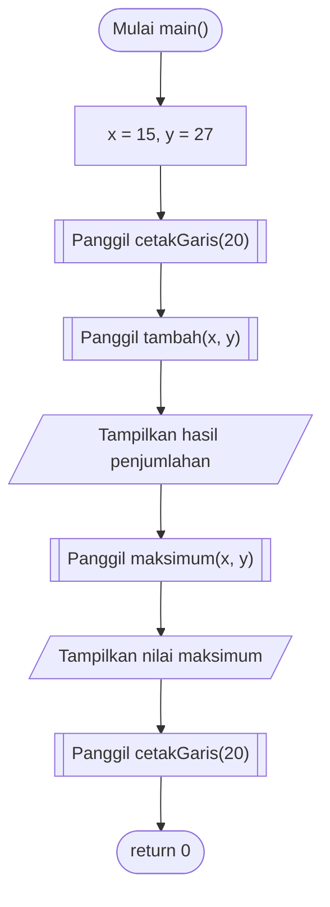
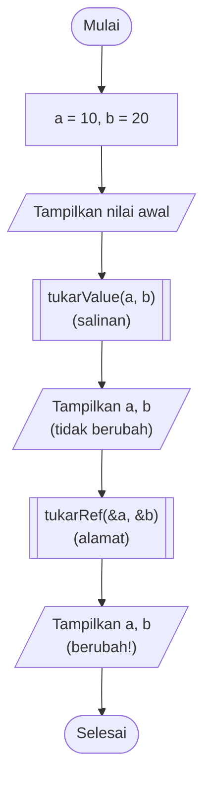
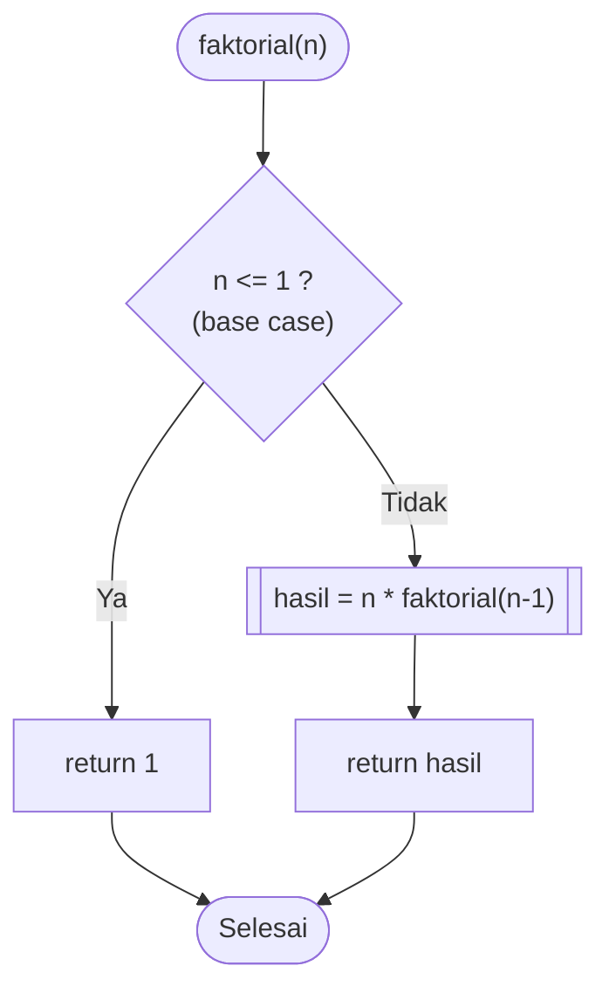
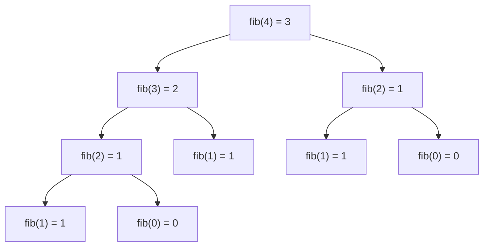

# 🧩 Modul 3: Fungsi dan Cakupan Variabel
<!-- 
## Daftar Isi
1. [Konsep Fungsi](#1-konsep-fungsi)
2. [Deklarasi (Prototipe) dan Definisi](#2-deklarasi-prototipe-dan-definisi)
3. [Cakupan Variabel (Scope)](#3-cakupan-variabel-scope)
4. [Pengiriman Parameter](#4-pengiriman-parameter)
5. [Rekursi](#5-rekursi)
6. [Latihan](#6-latihan)

--- -->

## 1. Konsep Fungsi

Fungsi adalah **blok kode bernama** yang dapat dipanggil berulang kali. Manfaatnya: kode lebih rapi, mudah diuji, dan tidak ditulis berulang.

```
   Masukan (parameter)        Fungsi (mesin)         Keluaran (return)
   ┌───────────────┐      ┌──────────────────┐      ┌───────────────┐
   │   a = 15      │ ───► │  tambah(a, b)    │ ───► │      42       │
   │   b = 27      │      │  return a + b;   │      │               │
   └───────────────┘      └──────────────────┘      └───────────────┘
```

**Bentuk umum:**

```c
tipe_kembalian nama_fungsi(tipe param1, tipe param2) {
    // isi fungsi
    return nilai;      // tidak perlu bila tipe_kembalian adalah void
}
```

---

## 2. Deklarasi (Prototipe) dan Definisi

Compiler membaca kode dari atas ke bawah. Agar `main()` boleh memanggil fungsi yang ditulis **di bawahnya**, tulis dulu **prototipe** di atas `main()`.

```
  ┌───────────────────────────────────────────┐
  │ #include <stdio.h>                        │
  │                                           │
  │ int tambah(int a, int b);   ◄── PROTOTIPE │  "janji" bahwa fungsi ada
  │                                           │
  │ int main() { ... tambah(x, y) ... }       │  pemakaian fungsi
  │                                           │
  │ int tambah(int a, int b) {  ◄── DEFINISI  │  implementasi sebenarnya
  │     return a + b;                         │
  │ }                                         │
  └───────────────────────────────────────────┘
```

### 2.1 Flowchart Pemanggilan Fungsi



> Simbol `[[ ]]` pada flowchart = **pemanggilan subprogram/fungsi**.

### 2.2 Program 3.1: Prototipe dan Definisi

```c
#include <stdio.h>

// ---- Prototipe fungsi ----
int  tambah(int a, int b);
int  maksimum(int a, int b);
void cetakGaris(int panjang);

int main() {
    int x = 15, y = 27;

    cetakGaris(20);
    printf("%d + %d = %d\n", x, y, tambah(x, y));
    printf("Maksimum  = %d\n", maksimum(x, y));
    cetakGaris(20);
    return 0;
}

// ---- Definisi fungsi ----
int tambah(int a, int b) {
    return a + b;
}

int maksimum(int a, int b) {
    if (a > b) return a;
    return b;
}

void cetakGaris(int panjang) {
    for (int i = 0; i < panjang; i++) {
        printf("=");
    }
    printf("\n");
}
```

**Hasil (Output):**

```
====================
15 + 27 = 42
Maksimum  = 27
====================
```

---

## 3. Cakupan Variabel (Scope)

| Jenis | Dideklarasikan | Dapat diakses | Umur |
|-------|----------------|---------------|------|
| **Lokal** | Di dalam fungsi/blok | Hanya di dalam fungsi/blok itu | Hilang saat fungsi selesai |
| **Global** | Di luar semua fungsi | Seluruh program | Selama program berjalan |
| **`static` lokal** | Di dalam fungsi, dengan `static` | Hanya di fungsi itu | Nilai **dipertahankan** antar pemanggilan |

```
   ┌─ GLOBAL (terlihat di mana-mana) ───────────────────────┐
   │  int global = 100;                                     │
   │                                                        │
   │   ┌─ main() ─────────┐     ┌─ fungsiA() ────────────┐  │
   │   │ int lokal = 1;   │     │ int lokal = 5;         │  │
   │   │ (lokal milik     │     │ (lokal milik fungsiA,  │  │
   │   │  main saja)      │     │  berbeda dengan main)  │  │
   │   └──────────────────┘     └────────────────────────┘  │
   └────────────────────────────────────────────────────────┘
```

### 3.1 Program 3.2: Scope Variabel

```c
#include <stdio.h>

int global = 100;               // variabel global

void fungsiA() {
    int lokal = 5;              // lokal milik fungsiA
    global += lokal;
    printf("Di fungsiA      : lokal=%d, global=%d\n", lokal, global);
}

void hitung() {
    static int n = 0;           // hanya diinisialisasi sekali
    n++;
    printf("hitung() dipanggil %d kali\n", n);
}

int main() {
    int lokal = 1;              // lokal milik main
    printf("Di main (awal)  : lokal=%d, global=%d\n", lokal, global);
    fungsiA();
    printf("Di main (akhir) : lokal=%d, global=%d\n", lokal, global);

    hitung();
    hitung();
    hitung();
    return 0;
}
```

**Hasil (Output):**

```
Di main (awal)  : lokal=1, global=100
Di fungsiA      : lokal=5, global=105
Di main (akhir) : lokal=1, global=105
hitung() dipanggil 1 kali
hitung() dipanggil 2 kali
hitung() dipanggil 3 kali
```

> 💡 Hindari terlalu banyak variabel global karena sulit dilacak perubahannya.

---

## 4. Pengiriman Parameter

### 4.1 Pass by Value (Kirim Salinan)

Fungsi menerima **salinan** nilai. Mengubah salinan **tidak** mengubah variabel asli.

### 4.2 Pass by Reference (Kirim Alamat)

Fungsi menerima **alamat memori** variabel (lewat pointer `*`). Fungsi dapat mengubah variabel asli. Pemanggil mengirim alamat dengan `&`.

> Pointer dibahas tuntas di [Modul 5](Modul-5-Pointer-dan-Memori-Dinamis.md). Di sini cukup pahami pola penggunaannya.

### 4.3 Ilustrasi Memori

```
 PASS BY VALUE: tukarValue(a, b)          PASS BY REFERENCE: tukarRef(&a, &b)

  main                 tukarValue              main                  tukarRef
 ┌──────────┐         ┌──────────┐            ┌──────────┐          ┌──────────┐
 │ a = 10   │ salin ► │ x = 10   │            │ a = 10   │◄─────────│ x ──┐    │
 │ b = 20   │ salin ► │ y = 20   │            │ b = 20   │◄─────────│ y ──┤    │
 └──────────┘         └──────────┘            └──────────┘ alamat   └─────┴────┘
  x,y ditukar → a,b TETAP                      *x,*y ditukar → a,b IKUT BERUBAH
```

### 4.4 Flowchart Perbandingan



### 4.5 Program 3.3: Value vs Reference

```c
#include <stdio.h>

void tukarValue(int x, int y);
void tukarRef(int *x, int *y);

int main() {
    int a = 10, b = 20;
    printf("Awal              : a=%d, b=%d\n", a, b);

    tukarValue(a, b);
    printf("Setelah by value  : a=%d, b=%d\n", a, b);

    tukarRef(&a, &b);
    printf("Setelah reference : a=%d, b=%d\n", a, b);
    return 0;
}

void tukarValue(int x, int y) {
    int temp = x;
    x = y;
    y = temp;
    printf("  Di dalam tukarValue: x=%d, y=%d\n", x, y);
}

void tukarRef(int *x, int *y) {
    int temp = *x;
    *x = *y;
    *y = temp;
}
```

**Hasil (Output):**

```
Awal              : a=10, b=20
  Di dalam tukarValue: x=20, y=10
Setelah by value  : a=10, b=20
Setelah reference : a=20, b=10
```

### 4.6 Ringkasan

| Aspek | Pass by Value | Pass by Reference |
|-------|---------------|-------------------|
| Yang dikirim | Salinan nilai | Alamat memori |
| Parameter fungsi | `int x` | `int *x` |
| Cara memanggil | `f(a)` | `f(&a)` |
| Variabel asli berubah? | ❌ Tidak | ✅ Ya |
| Kegunaan | Fungsi hanya perlu membaca nilai | Perlu mengubah/mengembalikan banyak nilai |

---

## 5. Rekursi

**Rekursi** = fungsi yang memanggil dirinya sendiri. Wajib memiliki:

1. **Base case**: syarat berhenti (tanpanya terjadi *stack overflow*).
2. **Recursive case**: pemanggilan diri dengan masalah yang **lebih kecil**.

### 5.1 Flowchart: Faktorial

`n! = n × (n-1)!`, dengan `0! = 1! = 1`.



### 5.2 Ilustrasi Tumpukan Pemanggilan (Call Stack) `faktorial(5)`

```
 Fase MASUK (memanggil)                   Fase KELUAR (mengembalikan nilai)

 faktorial(5) = 5 * faktorial(4)           faktorial(1) = 1
   faktorial(4) = 4 * faktorial(3)         faktorial(2) = 2 * 1   = 2
     faktorial(3) = 3 * faktorial(2)       faktorial(3) = 3 * 2   = 6
       faktorial(2) = 2 * faktorial(1)     faktorial(4) = 4 * 6   = 24
         faktorial(1) = 1  ◄─ BASE CASE    faktorial(5) = 5 * 24  = 120 ✔
```

### 5.3 Program 3.4: Faktorial dan Fibonacci

```c
#include <stdio.h>

long long faktorial(int n);
int fibonacci(int n);

int main() {
    printf("5!  = %lld\n", faktorial(5));
    printf("10! = %lld\n", faktorial(10));

    printf("Fibonacci (0..7): ");
    for (int i = 0; i <= 7; i++) {
        printf("%d ", fibonacci(i));
    }
    printf("\n");
    return 0;
}

long long faktorial(int n) {
    if (n <= 1) return 1;               // base case
    return n * faktorial(n - 1);        // recursive case
}

int fibonacci(int n) {
    if (n <= 1) return n;               // base case: F(0)=0, F(1)=1
    return fibonacci(n - 1) + fibonacci(n - 2);
}
```

**Hasil (Output):**

```
5!  = 120
10! = 3628800
Fibonacci (0..7): 0 1 1 2 3 5 8 13 
```

### 5.4 Pohon Pemanggilan `fibonacci(4)`



> ⚠️ `fib(2)` dihitung berulang kali. Rekursi Fibonacci ini mudah dipahami tetapi boros untuk `n` besar.

### 5.5 Rekursi vs Iterasi

| Aspek | Rekursi | Iterasi (loop) |
|-------|---------|----------------|
| Kode | Ringkas, mirip definisi matematis | Lebih panjang |
| Memori | Memakai stack tiap pemanggilan | Hemat |
| Risiko | *Stack overflow* tanpa base case | Infinite loop |

---

## 6. Latihan

1. Buat fungsi `luasLingkaran(float r)` yang mengembalikan luas, lalu panggil dari `main()`.
2. Buat fungsi `void ubahNilai(int *p)` yang menambah isi variabel sebesar 10, lalu buktikan variabel asli berubah.
3. Buat fungsi rekursif `pangkat(int basis, int eksp)`.
4. Buat fungsi rekursif untuk menjumlahkan `1 + 2 + ... + n`.
5. Buat fungsi `bool/int isPrima(int n)` dan tampilkan semua bilangan prima ≤ 50.

---

<!-- ⬅️ [Modul 2](Modul-2-Kontrol-Alur-Logika.md) | 🏠 [Daftar Isi](/bahasa-c/Modul-0-Algoritma-Flowchart-Pseudocode) | ➡️ [Modul 4: Struktur Data Dasar](Modul-4-Struktur-Data-Dasar.md) -->
