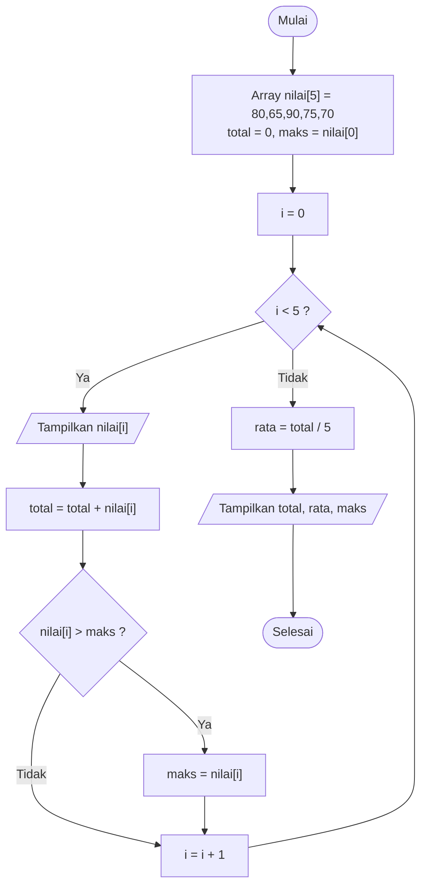
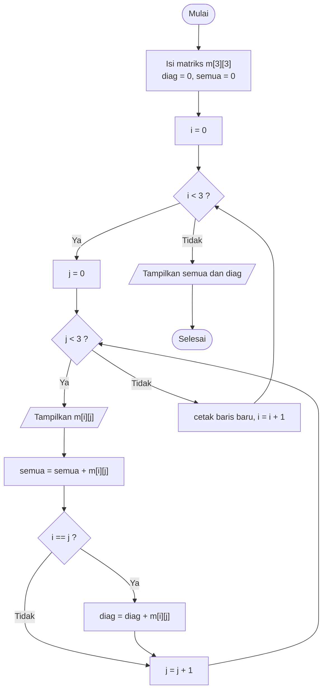
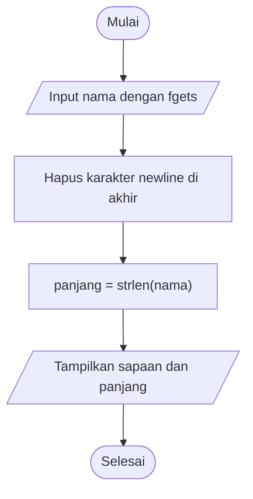
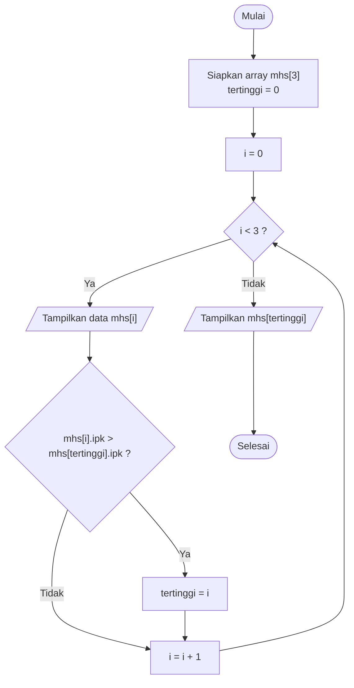

# 🗃️ Modul 4: Struktur Data Dasar
<!-- 
## Daftar Isi
1. [Array](#1-array)
2. [String](#2-string)
3. [Struct](#3-struct)
4. [Latihan](#4-latihan)

--- -->

## 1. Array

**Array** adalah kumpulan elemen **bertipe sama** yang disimpan pada **alokasi memori berurutan**. Elemen diakses lewat **indeks** yang dimulai dari **0**.

### 1.1 Array Satu Dimensi

```c
tipe nama_array[ukuran];
int nilai[5] = {80, 65, 90, 75, 70};
```

```
 int nilai[5]  → 5 kotak berurutan di memori

 indeks:    0      1      2      3      4
          ┌──────┬──────┬──────┬──────┬──────┐
 nilai    │  80  │  65  │  90  │  75  │  70  │
          └──────┴──────┴──────┴──────┴──────┘
 alamat:  1000   1004   1008   1012   1016    (tiap int = 4 byte)

 nilai[0] = 80       nilai[4] = 70       nilai[5] = ❌ di luar batas!
```

#### Flowchart: Total, Rata-rata, dan Nilai Tertinggi



#### Program 4.1

```c
#include <stdio.h>

int main() {
    int nilai[5] = {80, 65, 90, 75, 70};
    int total = 0, maks = nilai[0];

    for (int i = 0; i < 5; i++) {
        printf("nilai[%d] = %d\n", i, nilai[i]);
        total += nilai[i];
        if (nilai[i] > maks) {
            maks = nilai[i];
        }
    }

    printf("\nTotal     = %d\n", total);
    printf("Rata-rata = %.2f\n", (float)total / 5);
    printf("Tertinggi = %d\n", maks);
    return 0;
}
```

**Hasil (Output):**

```
nilai[0] = 80
nilai[1] = 65
nilai[2] = 90
nilai[3] = 75
nilai[4] = 70

Total     = 380
Rata-rata = 76.00
Tertinggi = 90
```

### 1.2 Array Dua Dimensi (Matriks)

```c
tipe nama[baris][kolom];
int m[3][3] = { {1,2,3}, {4,5,6}, {7,8,9} };
```

```
            kolom 0   kolom 1   kolom 2
          ┌─────────┬─────────┬─────────┐
 baris 0  │ m[0][0] │ m[0][1] │ m[0][2] │      1   2   3
          ├─────────┼─────────┼─────────┤
 baris 1  │ m[1][0] │ m[1][1] │ m[1][2] │  =   4   5   6
          ├─────────┼─────────┼─────────┤
 baris 2  │ m[2][0] │ m[2][1] │ m[2][2] │      7   8   9
          └─────────┴─────────┴─────────┘
  Diagonal utama: m[0][0], m[1][1], m[2][2]  →  1 + 5 + 9 = 15
```

#### Flowchart: Cetak Matriks dan Jumlah Diagonal



#### Program 4.2

```c
#include <stdio.h>

int main() {
    int m[3][3] = { {1, 2, 3},
                    {4, 5, 6},
                    {7, 8, 9} };
    int diagonal = 0, semua = 0;

    printf("Matriks 3x3:\n");
    for (int i = 0; i < 3; i++) {
        for (int j = 0; j < 3; j++) {
            printf("%3d", m[i][j]);
            semua += m[i][j];
            if (i == j) diagonal += m[i][j];
        }
        printf("\n");
    }
    printf("\nJumlah diagonal utama = %d\n", diagonal);
    printf("Jumlah seluruh elemen = %d\n", semua);
    return 0;
}
```

**Hasil (Output):**

```
Matriks 3x3:
  1  2  3
  4  5  6
  7  8  9

Jumlah diagonal utama = 15
Jumlah seluruh elemen = 45
```

---

## 2. String

**String** di C adalah **array `char` yang wajib diakhiri karakter null `\0`** sebagai penanda akhir.

```c
char nama[] = "Budi";     // otomatis menjadi 5 elemen (4 huruf + \0)
```

```
 char nama[5] = "Budi";

 indeks:   0     1     2     3     4
        ┌─────┬─────┬─────┬─────┬─────┐
 nama   │ 'B' │ 'u' │ 'd' │ 'i' │ '\0'│
        └─────┴─────┴─────┴─────┴─────┘
                                  ▲
                      penanda akhir string (tidak dihitung strlen)
```

### 2.1 Fungsi Pustaka `<string.h>`

| Fungsi | Kegunaan | Contoh |
|--------|----------|--------|
| `strlen(s)` | Panjang string (tanpa `\0`) | `strlen("Halo")` → 4 |
| `strcpy(tujuan, asal)` | Menyalin string | `strcpy(b, a)` |
| `strcat(tujuan, asal)` | Menyambung string | `strcat(a, " Dunia")` |
| `strcmp(s1, s2)` | Membandingkan: `0` sama, `<0` s1 lebih dulu, `>0` s1 sesudah | `strcmp("a","b")` → negatif |

> ⚠️ String **tidak bisa** disalin dengan `=` atau dibandingkan dengan `==`. Gunakan `strcpy` dan `strcmp`.

### 2.2 Flowchart: Input Nama dan Hitung Karakter



### 2.3 Program 4.3: Input String

```c
#include <stdio.h>
#include <string.h>

int main() {
    char nama[50];

    printf("Masukkan nama lengkap: ");
    fgets(nama, sizeof(nama), stdin);
    nama[strcspn(nama, "\n")] = '\0';     // buang \n bawaan fgets

    printf("Halo, %s!\n", nama);
    printf("Nama Anda terdiri dari %zu karakter.\n", strlen(nama));
    return 0;
}
```

**Hasil (Output)** (masukan `Budi Santoso`):

```
Masukkan nama lengkap: Budi Santoso
Halo, Budi Santoso!
Nama Anda terdiri dari 12 karakter.
```

> 💡 `fgets` aman untuk membaca kalimat berspasi. `scanf("%s")` berhenti di spasi pertama dan rawan *buffer overflow*.

### 2.4 Program 4.4: `strlen`, `strcpy`, `strcat`, `strcmp`

```c
#include <stdio.h>
#include <string.h>

int main() {
    char sapaan[30] = "Halo";
    char salinan[30];
    char kata1[] = "apel";
    char kata2[] = "bapak";

    printf("Panjang \"%s\"      : %zu\n", sapaan, strlen(sapaan));

    strcpy(salinan, sapaan);
    printf("Hasil strcpy         : %s\n", salinan);

    strcat(sapaan, " Dunia");
    printf("Hasil strcat         : %s\n", sapaan);
    printf("Panjang setelah cat  : %zu\n", strlen(sapaan));

    int hasil = strcmp(kata1, kata2);
    if (hasil == 0)
        printf("\"%s\" sama dengan \"%s\"\n", kata1, kata2);
    else if (hasil < 0)
        printf("\"%s\" berada SEBELUM \"%s\" (urutan kamus)\n", kata1, kata2);
    else
        printf("\"%s\" berada SESUDAH \"%s\" (urutan kamus)\n", kata1, kata2);
    return 0;
}
```

**Hasil (Output):**

```
Panjang "Halo"      : 4
Hasil strcpy         : Halo
Hasil strcat         : Halo Dunia
Panjang setelah cat  : 10
"apel" berada SEBELUM "bapak" (urutan kamus)
```

---

## 3. Struct

**Struct** mengelompokkan beberapa variabel **bertipe berbeda** dalam satu tipe data kustom. Cocok untuk merepresentasikan satu "entitas" (mahasiswa, produk, buku).

```c
struct Mahasiswa {
    char  nama[30];
    int   nim;
    float ipk;
};
```

```
   struct Mahasiswa  (satu "kartu data")
   ┌──────────────────────────────┐
   │ nama : "Citra"   (char[30])  │
   │ nim  : 2024003   (int)       │
   │ ipk  : 3.90      (float)     │
   └──────────────────────────────┘
   Akses anggota dengan operator titik:  mhs.nama   mhs.nim   mhs.ipk
```

### 3.1 Flowchart: Mencari Mahasiswa ber-IPK Tertinggi



### 3.2 Program 4.5: Array of Struct

```c
#include <stdio.h>

struct Mahasiswa {
    char  nama[30];
    int   nim;
    float ipk;
};

int main() {
    struct Mahasiswa mhs[3] = {
        {"Ani",   2024001, 3.75f},
        {"Budi",  2024002, 3.40f},
        {"Citra", 2024003, 3.90f}
    };
    int tertinggi = 0;

    printf("%-8s %-10s %s\n", "Nama", "NIM", "IPK");
    printf("-----------------------------\n");
    for (int i = 0; i < 3; i++) {
        printf("%-8s %-10d %.2f\n", mhs[i].nama, mhs[i].nim, mhs[i].ipk);
        if (mhs[i].ipk > mhs[tertinggi].ipk) {
            tertinggi = i;
        }
    }

    printf("\nIPK tertinggi: %s (%.2f)\n",
           mhs[tertinggi].nama, mhs[tertinggi].ipk);
    return 0;
}
```

**Hasil (Output):**

```
Nama     NIM        IPK
-----------------------------
Ani      2024001    3.75
Budi     2024002    3.40
Citra    2024003    3.90

IPK tertinggi: Citra (3.90)
```

### 3.3 Perbandingan Array vs Struct

| | Array | Struct |
|---|-------|--------|
| Tipe elemen | **Sama** semua | Boleh **berbeda** |
| Akses elemen | Indeks `a[i]` | Nama anggota `s.nama` |
| Contoh | Daftar 5 nilai | Data 1 mahasiswa |
| Gabungan | `struct Mahasiswa mhs[3]` = **array of struct** | |

---

## 4. Latihan

1. Isi array 10 bilangan dari `scanf`, lalu tampilkan nilai **terkecil** dan **terbesar**.
2. Balik urutan isi array (`1 2 3 4 5` → `5 4 3 2 1`).
3. Jumlahkan dua matriks 2×2 dan tampilkan hasilnya.
4. Buat program yang mengecek apakah sebuah kata adalah **palindrom** (contoh: `katak`).
5. Buat `struct Buku` (judul, pengarang, harga), isi 3 data, tampilkan buku termahal.

### ❗ Kesalahan Umum

| Kesalahan | Akibat |
|-----------|--------|
| Mengakses `arr[5]` pada array ukuran 5 | Di luar batas, perilaku tak terdefinisi |
| Lupa ruang untuk `\0` | String rusak / *buffer overflow* |
| `if (s1 == s2)` untuk string | Membandingkan alamat, bukan isi |
| `s1 = s2` untuk string | *Compile error*; gunakan `strcpy` |

---

⬅️ [Modul 3](Modul-3-Fungsi-dan-Cakupan-Variabel.md) | 🏠 [Daftar Isi](/bahasa-c/Modul-0-Algoritma-Flowchart-Pseudocode) | ➡️ [Modul 5: Pointer dan Memori Dinamis](Modul-5-Pointer-dan-Memori-Dinamis.md)
