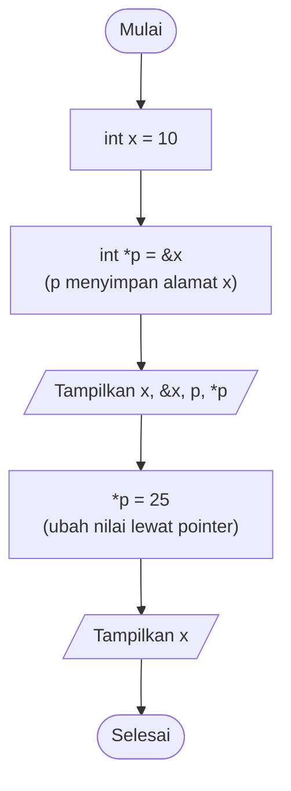
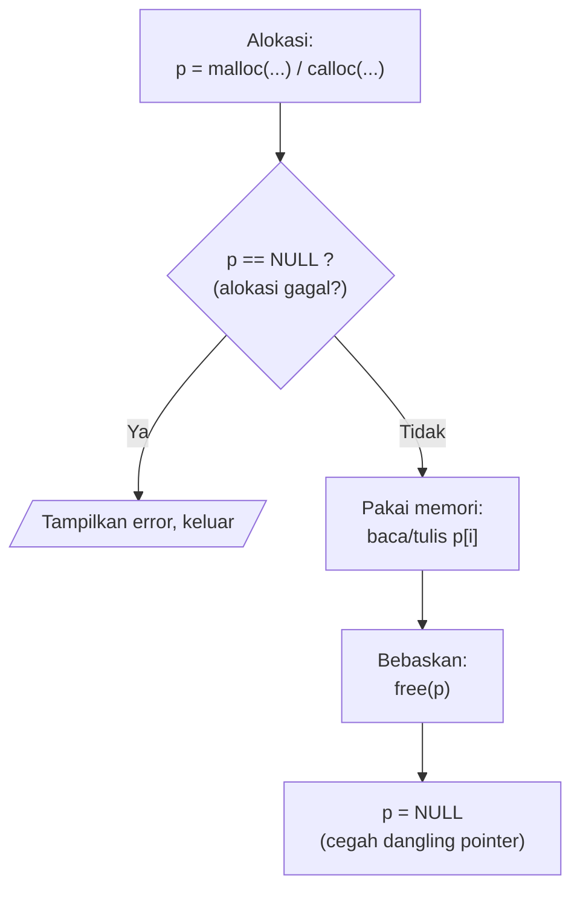
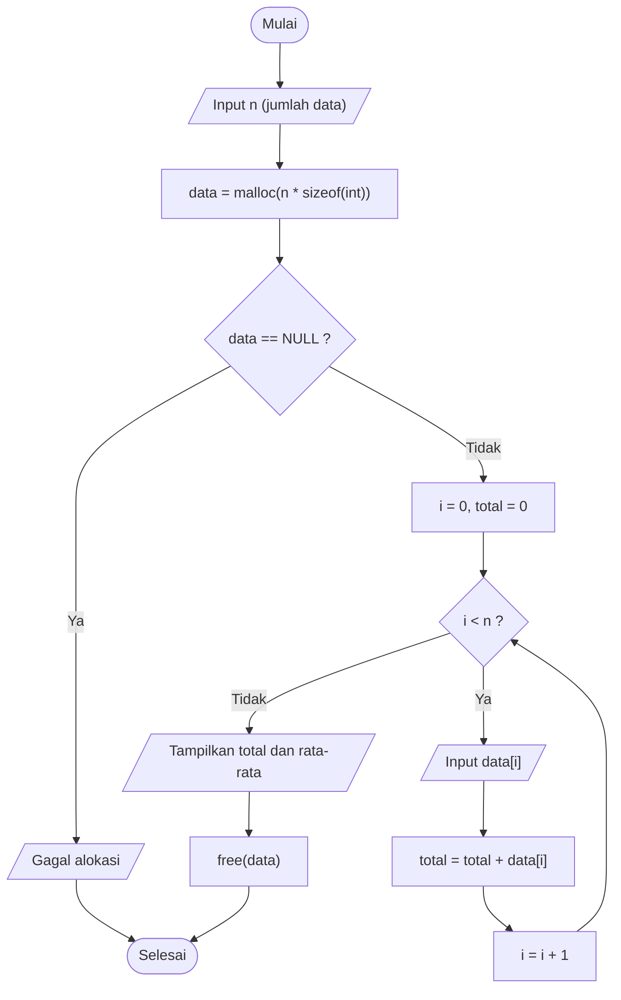

# 📍 Modul 5: Pointer dan Memori Dinamis

<!-- ## Daftar Isi
1. [Konsep Pointer](#1-konsep-pointer)
2. [Operator Pointer `&` dan `*`](#2-operator-pointer--dan-)
3. [Pointer dan Array](#3-pointer-dan-array)
4. [Memori Dinamis](#4-manajemen-memori-dinamis)
5. [Kesalahan Umum](#5-kesalahan-umum)
6. [Latihan](#6-latihan)

--- -->

## 1. Konsep Pointer

Setiap variabel menempati **alamat** di memori. **Pointer** adalah variabel khusus yang **menyimpan alamat** variabel lain.

Analogi: variabel = **rumah** berisi barang; pointer = **kertas catatan** berisi alamat rumah itu.

```
   Memori komputer

   alamat       isi            nama
 ┌─────────┬─────────────┬─────────────┐
 │ 0x1000  │     10      │  x          │ ◄────────┐
 ├─────────┼─────────────┼─────────────┤          │
 │ 0x1004  │   0x1000    │  p  ────────┼──────────┘  p "menunjuk" ke x
 └─────────┴─────────────┴─────────────┘
              int x = 10;      int *p = &x;
```

---

## 2. Operator Pointer `&` dan `*`

| Operator | Nama | Fungsi | Contoh |
|----------|------|--------|--------|
| `&` | *Address-of* | Mengambil **alamat** variabel | `&x` |
| `*` (saat deklarasi) | Pembuat pointer | Menyatakan variabel adalah pointer | `int *p;` |
| `*` (saat dipakai) | *Dereference* | Mengakses/mengubah **nilai** pada alamat yang ditunjuk | `*p = 25;` |

### 2.1 Flowchart



### 2.2 Program 5.1: Dasar Pointer

```c
#include <stdio.h>

int main() {
    int x = 10;
    int *p = &x;                    // p menunjuk ke x

    printf("Nilai x        : %d\n", x);
    printf("Alamat x (&x)  : %p\n", (void *)&x);
    printf("Isi p          : %p\n", (void *)p);
    printf("Nilai *p       : %d\n", *p);

    *p = 25;                        // mengubah x lewat pointer
    printf("\nSetelah *p = 25\n");
    printf("Nilai x        : %d\n", x);
    return 0;
}
```

**Hasil (Output):** *(alamat berbeda di tiap komputer/eksekusi)*

```
Nilai x        : 10
Alamat x (&x)  : 0x7ffd5a3c1a4c
Isi p          : 0x7ffd5a3c1a4c
Nilai *p       : 10

Setelah *p = 25
Nilai x        : 25
```

> 🔑 `p` dan `&x` berisi alamat yang **sama**; `*p` dan `x` mengakses isi yang **sama**.

---

## 3. Pointer dan Array

Nama array adalah alamat elemen pertamanya. Maka `arr` setara `&arr[0]`, dan `*(p + i)` setara `arr[i]`.

```
   int arr[3] = {10, 20, 30};     int *p = arr;

   p ──────┐
           ▼
        ┌──────┬──────┬──────┐
 arr    │  10  │  20  │  30  │
        └──────┴──────┴──────┘
        p+0     p+1    p+2        (p+1 maju 1 elemen = 4 byte untuk int)
```

### 3.1 Program 5.2: Aritmatika Pointer

```c
#include <stdio.h>

int main() {
    int arr[3] = {10, 20, 30};
    int *p = arr;

    for (int i = 0; i < 3; i++) {
        printf("*(p+%d) = %d   (sama dengan arr[%d] = %d)\n",
               i, *(p + i), i, arr[i]);
    }
    return 0;
}
```

**Hasil (Output):**

```
*(p+0) = 10   (sama dengan arr[0] = 10)
*(p+1) = 20   (sama dengan arr[1] = 20)
*(p+2) = 30   (sama dengan arr[2] = 30)
```

---

## 4. Manajemen Memori Dinamis

Array biasa berukuran **tetap** saat kompilasi. Dengan memori dinamis, ukuran ditentukan **saat program berjalan (runtime)** di area memori bernama **heap**. Perlu `#include <stdlib.h>`.

```
   ┌───────────────────────────────────────────────┐
   │  STACK   variabel lokal, parameter fungsi     │  otomatis, ukuran tetap
   ├───────────────────────────────────────────────┤
   │  HEAP    malloc / calloc / free               │  manual, fleksibel  ◄── fokus modul ini
   ├───────────────────────────────────────────────┤
   │  DATA    variabel global dan static           │
   ├───────────────────────────────────────────────┤
   │  CODE    instruksi program                    │
   └───────────────────────────────────────────────┘
```

| Fungsi | Kegunaan | Sintaks |
|--------|----------|---------|
| `malloc()` | Alokasi blok memori, isi **belum terdefinisi** (sampah) | `p = malloc(n * sizeof(int));` |
| `calloc()` | Alokasi blok memori, semua isi **diatur 0** | `p = calloc(n, sizeof(int));` |
| `free()` | **Membebaskan** memori kembali ke sistem | `free(p);` |

### 4.1 Siklus Hidup Memori Dinamis



### 4.2 Flowchart: Hitung Total dan Rata-rata dengan `malloc`



### 4.3 Program 5.3: `malloc` dan `free`

```c
#include <stdio.h>
#include <stdlib.h>

int main() {
    int n;
    printf("Berapa banyak data? ");
    scanf("%d", &n);

    int *data = (int *)malloc(n * sizeof(int));
    if (data == NULL) {
        printf("Alokasi memori gagal!\n");
        return 1;
    }

    int total = 0;
    for (int i = 0; i < n; i++) {
        printf("Data ke-%d: ", i + 1);
        scanf("%d", &data[i]);
        total += data[i];
    }

    printf("\nTotal     = %d\n", total);
    printf("Rata-rata = %.2f\n", (float)total / n);

    free(data);          // bebaskan memori
    data = NULL;
    return 0;
}
```

**Hasil (Output)** (masukan `3`, lalu `5`, `10`, `15`):

```
Berapa banyak data? 3
Data ke-1: 5
Data ke-2: 10
Data ke-3: 15

Total     = 30
Rata-rata = 10.00
```

### 4.4 Program 5.4: `calloc` vs `malloc`

```c
#include <stdio.h>
#include <stdlib.h>

int main() {
    int n = 5;
    int *a = (int *)calloc(n, sizeof(int));   // semua = 0
    if (a == NULL) return 1;

    printf("Isi awal setelah calloc : ");
    for (int i = 0; i < n; i++) printf("%d ", a[i]);

    for (int i = 0; i < n; i++) a[i] = (i + 1) * 10;

    printf("\nSetelah diisi manual    : ");
    for (int i = 0; i < n; i++) printf("%d ", a[i]);
    printf("\n");

    free(a);
    return 0;
}
```

**Hasil (Output):**

```
Isi awal setelah calloc : 0 0 0 0 0 
Setelah diisi manual    : 10 20 30 40 50 
```

> 💡 Jika memakai `malloc`, isi awal berupa nilai acak (sampah memori), sehingga harus diinisialisasi sendiri.

### 4.5 Ilustrasi Kebocoran Memori (*Memory Leak*)

```
  TANPA free():                              DENGAN free():

  int *p = malloc(100);                      int *p = malloc(100);
  p = NULL;   ← alamat hilang!               free(p);
                                             p = NULL;
  Heap: [██ 100 byte ██]  ← terpakai terus   Heap: [░░ bebas kembali ░░]
        tidak bisa dipakai lagi 😱                 dapat dipakai program lain ✅
```

---

## 5. Kesalahan Umum

| Kesalahan | Penjelasan | Solusi |
|-----------|------------|--------|
| Lupa `free()` | Kebocoran memori | Pasangkan setiap `malloc/calloc` dengan `free` |
| Memakai pointer setelah `free` | *Dangling pointer* | Set `p = NULL` setelah `free` |
| `free()` dua kali pada alamat sama | *Double free*, crash | Set `NULL` setelah `free` |
| Tidak cek `NULL` | Crash bila alokasi gagal | `if (p == NULL) {...}` |
| Pointer tak terinisialisasi `int *p; *p = 5;` | Menulis ke alamat acak | Selalu isi `p` dulu |
| Akses di luar batas blok | Perilaku tak terdefinisi | Perhatikan ukuran alokasi |

> 📎 Untuk mengubah ukuran blok yang sudah dialokasikan, gunakan `realloc(p, ukuranBaru)`.

---

## 6. Latihan

1. Buat program yang mengubah nilai variabel `int` melalui pointer, lalu tampilkan alamat dan nilainya.
2. Cetak isi array memakai **hanya** notasi pointer (`*(p+i)`).
3. Minta pengguna memasukkan `n`, alokasikan array `float` dengan `calloc`, isi nilainya, lalu cari nilai terbesar.
4. Buat fungsi `void kuadrat(int *p)` yang mengkuadratkan nilai yang ditunjuk.
5. Buat string dinamis: alokasikan `char` sebanyak 50 dengan `malloc`, isi dengan `fgets`, tampilkan, lalu `free`.

---

<!-- ⬅️ [Modul 4](Modul-4-Struktur-Data-Dasar.md) | 🏠 [Daftar Isi](/bahasa-c/Modul-0-Algoritma-Flowchart-Pseudocode) | ➡️ [Modul 6: Algoritma Dasar](Modul-6-Contoh-Implentasi-Algoritma-Dasar.md) -->
