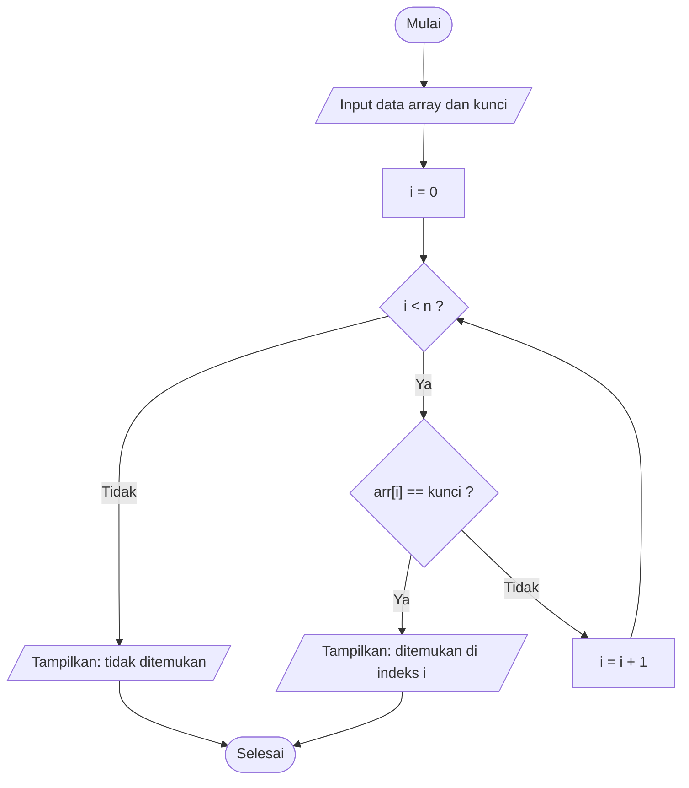
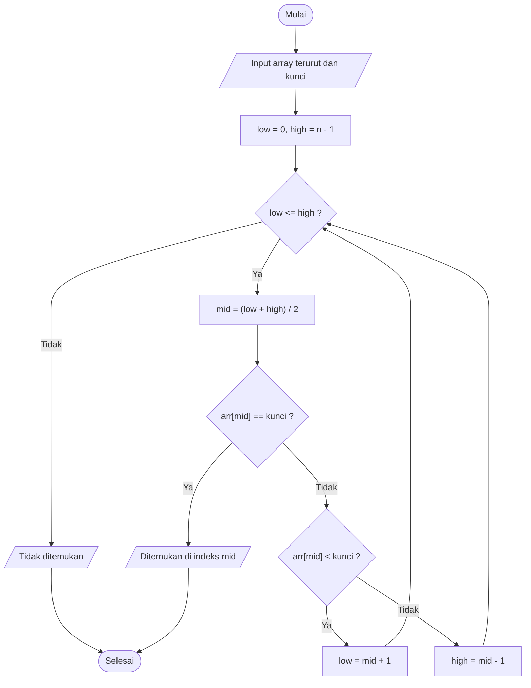
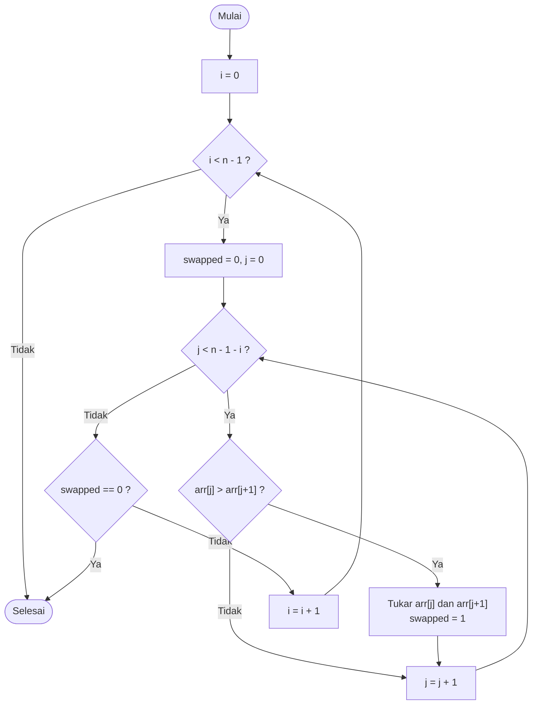
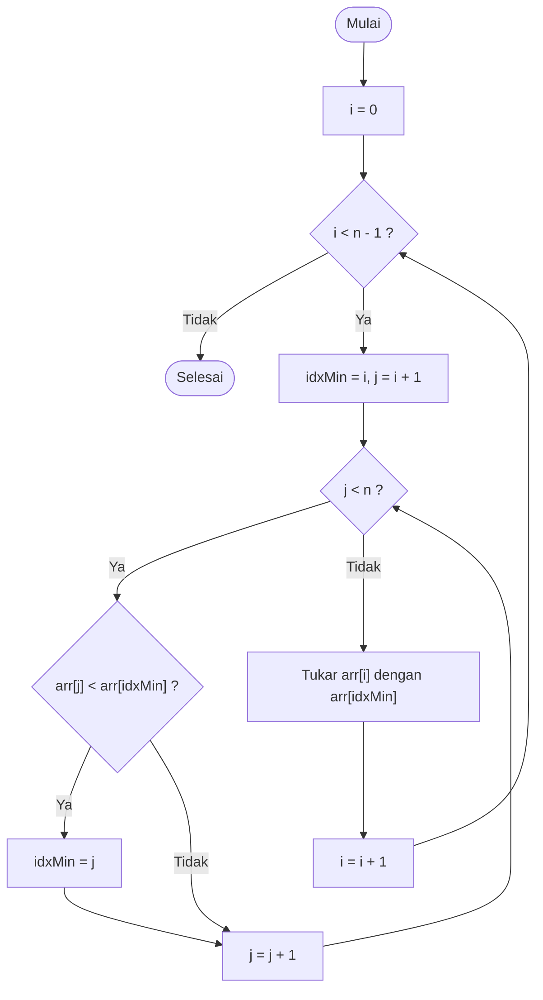
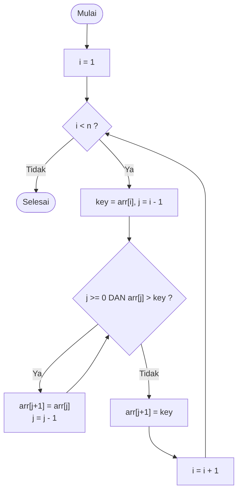
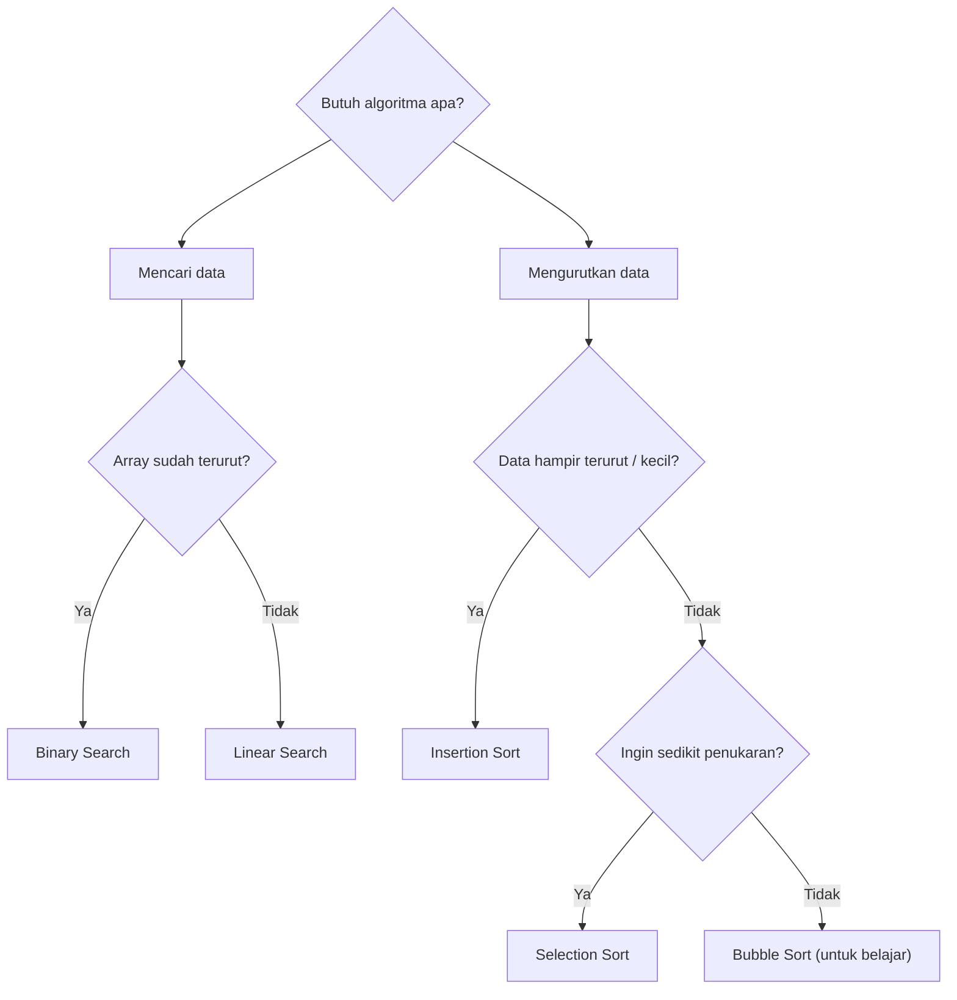

# 🔎 Modul 6: Algoritma Dasar
<!-- 
## Daftar Isi
1. [Pengantar Kompleksitas Waktu](#1-pengantar-kompleksitas-waktu)
2. [Pencarian Data](#2-pencarian-data)
3. [Pengurutan Data](#3-pengurutan-data)
4. [Perbandingan Algoritma](#4-perbandingan-algoritma)
5. [Latihan](#5-latihan)

--- -->

## 1. Pengantar Kompleksitas Waktu

**Kompleksitas waktu** menyatakan seberapa cepat jumlah langkah algoritma bertambah ketika jumlah data `n` membesar. Ditulis dengan notasi **Big-O**.

| Notasi | Nama | Contoh | Untuk n = 1.000.000 |
|--------|------|--------|---------------------|
| $O(1)$ | Konstan | Akses `arr[i]` | 1 langkah |
| $O(\log n)$ | Logaritmik | Binary search | ± 20 langkah |
| $O(n)$ | Linear | Linear search | 1.000.000 langkah |
| $O(n^2)$ | Kuadratik | Bubble/Selection/Insertion sort | 1.000.000.000.000 langkah |

```
  Jumlah langkah
   ▲
   │                                      /  O(n²)
   │                                    /
   │                                  /     /  O(n)
   │                               /     /
   │                           /     /
   │                      _.-'    /      ______ O(log n)
   │              _.--'''   /  __---'''
   │     _.---'''   __---''''
   └────────────────────────────────────────────► jumlah data n
```

---

## 2. Pencarian Data

### 2.1 Linear Search: $O(n)$

Memeriksa elemen **satu per satu dari awal** sampai ketemu atau data habis. Array **tidak perlu terurut**.

```
 Cari 12 pada {8, 3, 7, 12, 5, 9}

 indeks:   0     1     2     3     4     5
         ┌───┐ ┌───┐ ┌───┐ ┌───┐ ┌───┐ ┌───┐
         │ 8 │ │ 3 │ │ 7 │ │12 │ │ 5 │ │ 9 │
         └───┘ └───┘ └───┘ └───┘ └───┘ └───┘
          ≠12   ≠12   ≠12   =12 ✔  (berhenti)
```

#### Flowchart



#### Program 6.1

```c
#include <stdio.h>

int linearSearch(int arr[], int n, int kunci);

int main() {
    int data[] = {8, 3, 7, 12, 5, 9};
    int n = sizeof(data) / sizeof(data[0]);
    int cari[] = {12, 4};

    for (int k = 0; k < 2; k++) {
        int idx = linearSearch(data, n, cari[k]);
        if (idx != -1)
            printf("Data %d ditemukan pada indeks %d\n", cari[k], idx);
        else
            printf("Data %d tidak ditemukan\n", cari[k]);
    }
    return 0;
}

int linearSearch(int arr[], int n, int kunci) {
    for (int i = 0; i < n; i++) {
        if (arr[i] == kunci) return i;
    }
    return -1;      // tidak ditemukan
}
```

**Hasil (Output):**

```
Data 12 ditemukan pada indeks 3
Data 4 tidak ditemukan
```

### 2.2 Binary Search: $O(\log n)$

Syarat: array **sudah terurut**. Setiap langkah membandingkan dengan elemen **tengah**, lalu membuang separuh ruang pencarian.

```
 Cari 23 pada {2, 5, 8, 12, 16, 23, 38, 56, 72, 91}

 Langkah 1: low=0, high=9 → mid=4
   [ 2  5  8 12 (16) 23 38 56 72 91 ]    16 < 23 → buang kiri, low = 5

 Langkah 2: low=5, high=9 → mid=7
   [ 23 38 (56) 72 91 ]                  56 > 23 → buang kanan, high = 6

 Langkah 3: low=5, high=6 → mid=5
   [ (23) 38 ]                           23 = 23 ✔ ditemukan di indeks 5
```

#### Flowchart



#### Program 6.2

```c
#include <stdio.h>

int binarySearch(int arr[], int n, int kunci);

int main() {
    int data[] = {2, 5, 8, 12, 16, 23, 38, 56, 72, 91};
    int n = sizeof(data) / sizeof(data[0]);
    int kunci = 23;

    int idx = binarySearch(data, n, kunci);
    if (idx != -1)
        printf("Data %d ditemukan pada indeks %d\n", kunci, idx);
    else
        printf("Data %d tidak ditemukan\n", kunci);
    return 0;
}

int binarySearch(int arr[], int n, int kunci) {
    int low = 0, high = n - 1, langkah = 1;

    while (low <= high) {
        int mid = (low + high) / 2;
        printf("Langkah %d: low=%d, high=%d, mid=%d, arr[mid]=%d\n",
               langkah++, low, high, mid, arr[mid]);

        if (arr[mid] == kunci)      return mid;
        else if (arr[mid] < kunci)  low = mid + 1;
        else                        high = mid - 1;
    }
    return -1;
}
```

**Hasil (Output):**

```
Langkah 1: low=0, high=9, mid=4, arr[mid]=16
Langkah 2: low=5, high=9, mid=7, arr[mid]=56
Langkah 3: low=5, high=6, mid=5, arr[mid]=23
Data 23 ditemukan pada indeks 5
```

---

## 3. Pengurutan Data

Semua contoh mengurutkan **naik (ascending)**.

### 3.1 Bubble Sort

**Ide:** bandingkan dua elemen bersebelahan, tukar jika urutannya salah. Setelah tiap putaran, elemen terbesar "mengapung" ke ujung kanan seperti gelembung.

```
 Data awal: [5, 1, 4, 2, 8]

 Putaran 1:  (5 1) 4 2 8 → tukar → 1 5 4 2 8
              1 (5 4) 2 8 → tukar → 1 4 5 2 8
              1 4 (5 2) 8 → tukar → 1 4 2 5 8
              1 4 2 (5 8) → aman   → 1 4 2 5 [8]✔

 Putaran 2:   1 4 2 5 [8]  →  1 2 4 5 [8]
```

#### Flowchart



#### Program 6.3

```c
#include <stdio.h>

void cetak(int arr[], int n) {
    for (int i = 0; i < n; i++) printf("%d ", arr[i]);
    printf("\n");
}

void bubbleSort(int arr[], int n) {
    for (int i = 0; i < n - 1; i++) {
        int swapped = 0;
        for (int j = 0; j < n - 1 - i; j++) {
            if (arr[j] > arr[j + 1]) {
                int temp = arr[j];
                arr[j] = arr[j + 1];
                arr[j + 1] = temp;
                swapped = 1;
            }
        }
        printf("Putaran %d: ", i + 1);
        cetak(arr, n);
        if (!swapped) break;       // sudah terurut, berhenti lebih awal
    }
}

int main() {
    int data[] = {5, 1, 4, 2, 8};
    int n = sizeof(data) / sizeof(data[0]);

    printf("Sebelum : ");
    cetak(data, n);
    bubbleSort(data, n);
    printf("Sesudah : ");
    cetak(data, n);
    return 0;
}
```

**Hasil (Output):**

```
Sebelum : 5 1 4 2 8 
Putaran 1: 1 4 2 5 8 
Putaran 2: 1 2 4 5 8 
Putaran 3: 1 2 4 5 8 
Sesudah : 1 2 4 5 8 
```

### 3.2 Selection Sort

**Ide:** cari elemen **terkecil** dari bagian yang belum terurut, lalu tempatkan di posisi paling kiri bagian itu.

```
 Data awal: [64, 25, 12, 22, 11]

 i=0: min = 11 (indeks 4)  tukar dengan 64  → [11] 25 12 22 64
 i=1: min = 12 (indeks 2)  tukar dengan 25  → 11 [12] 25 22 64
 i=2: min = 22 (indeks 3)  tukar dengan 25  → 11 12 [22] 25 64
 i=3: min = 25 (indeks 3)  sudah di tempat  → 11 12 22 [25] 64 ✔
```

#### Flowchart



#### Program 6.4

```c
#include <stdio.h>

void cetak(int arr[], int n) {
    for (int i = 0; i < n; i++) printf("%d ", arr[i]);
    printf("\n");
}

void selectionSort(int arr[], int n) {
    for (int i = 0; i < n - 1; i++) {
        int idxMin = i;
        for (int j = i + 1; j < n; j++) {
            if (arr[j] < arr[idxMin]) idxMin = j;
        }
        int temp = arr[i];
        arr[i] = arr[idxMin];
        arr[idxMin] = temp;

        printf("Langkah %d: ", i + 1);
        cetak(arr, n);
    }
}

int main() {
    int data[] = {64, 25, 12, 22, 11};
    int n = sizeof(data) / sizeof(data[0]);

    printf("Sebelum : ");
    cetak(data, n);
    selectionSort(data, n);
    printf("Sesudah : ");
    cetak(data, n);
    return 0;
}
```

**Hasil (Output):**

```
Sebelum : 64 25 12 22 11 
Langkah 1: 11 25 12 22 64 
Langkah 2: 11 12 25 22 64 
Langkah 3: 11 12 22 25 64 
Langkah 4: 11 12 22 25 64 
Sesudah : 11 12 22 25 64 
```

### 3.3 Insertion Sort

**Ide:** seperti menyusun kartu di tangan. Ambil satu elemen (`key`), lalu **sisipkan** pada posisi yang tepat di bagian kiri yang sudah terurut.

```
 Data awal: [12, 11, 13, 5, 6]

 i=1: key=11  → geser 12 ke kanan, sisip   → [11 12] 13 5 6
 i=2: key=13  → tidak ada yang digeser     → [11 12 13] 5 6
 i=3: key=5   → geser 13,12,11, sisip      → [5 11 12 13] 6
 i=4: key=6   → geser 13,12,11, sisip      → [5 6 11 12 13] ✔
```

#### Flowchart



#### Program 6.5

```c
#include <stdio.h>

void cetak(int arr[], int n) {
    for (int i = 0; i < n; i++) printf("%d ", arr[i]);
    printf("\n");
}

void insertionSort(int arr[], int n) {
    for (int i = 1; i < n; i++) {
        int key = arr[i];
        int j = i - 1;

        while (j >= 0 && arr[j] > key) {
            arr[j + 1] = arr[j];    // geser ke kanan
            j--;
        }
        arr[j + 1] = key;           // sisipkan

        printf("Langkah %d (key=%d): ", i, key);
        cetak(arr, n);
    }
}

int main() {
    int data[] = {12, 11, 13, 5, 6};
    int n = sizeof(data) / sizeof(data[0]);

    printf("Sebelum : ");
    cetak(data, n);
    insertionSort(data, n);
    printf("Sesudah : ");
    cetak(data, n);
    return 0;
}
```

**Hasil (Output):**

```
Sebelum : 12 11 13 5 6 
Langkah 1 (key=11): 11 12 13 5 6 
Langkah 2 (key=13): 11 12 13 5 6 
Langkah 3 (key=5): 5 11 12 13 6 
Langkah 4 (key=6): 5 6 11 12 13 
Sesudah : 5 6 11 12 13 
```

---

## 4. Perbandingan Algoritma

### 4.1 Pencarian

| | Linear Search | Binary Search |
|---|---------------|---------------|
| Syarat array | Bebas | **Harus terurut** |
| Kompleksitas terburuk | $O(n)$ | $O(\log n)$ |
| Kecepatan data besar | Lambat | Sangat cepat |
| Kesederhanaan | Sangat sederhana | Sedikit lebih rumit |

### 4.2 Pengurutan

| Algoritma | Terbaik | Rata-rata / Terburuk | Karakteristik |
|-----------|---------|----------------------|---------------|
| Bubble Sort | $O(n)$ (dengan flag `swapped`) | $O(n^2)$ | Banyak penukaran, mudah dipahami |
| Selection Sort | $O(n^2)$ | $O(n^2)$ | Penukaran sedikit (maks `n-1`), selalu $n^2$ perbandingan |
| Insertion Sort | $O(n)$ | $O(n^2)$ | Cepat untuk data hampir terurut atau data kecil |



> 💡 Untuk data besar di dunia nyata dipakai algoritma $O(n \log n)$ seperti Merge Sort, Quick Sort, atau fungsi `qsort()` dari `<stdlib.h>`.

---

## 5. Latihan

1. Modifikasi linear search agar menampilkan **semua indeks** kemunculan sebuah nilai.
2. Ubah Bubble Sort agar mengurutkan **menurun (descending)**.
3. Hitung dan tampilkan **jumlah perbandingan** yang dilakukan Selection Sort pada array 10 elemen.
4. Urutkan array string nama (2D char) memakai Insertion Sort dan `strcmp`.
5. Gabungkan: urutkan array dengan Insertion Sort, lalu cari sebuah nilai dengan Binary Search.

---

⬅️ [Modul 5](Modul-5-Pointer-dan-Memori-Dinamis.md) | 🏠 [Daftar Isi](/bahasa-c/Modul-0-Algoritma-Flowchart-Pseudocode) | ➡️ [Modul 7: Operasi Berkas](Modul-7-Operasi-Berkas.md)
