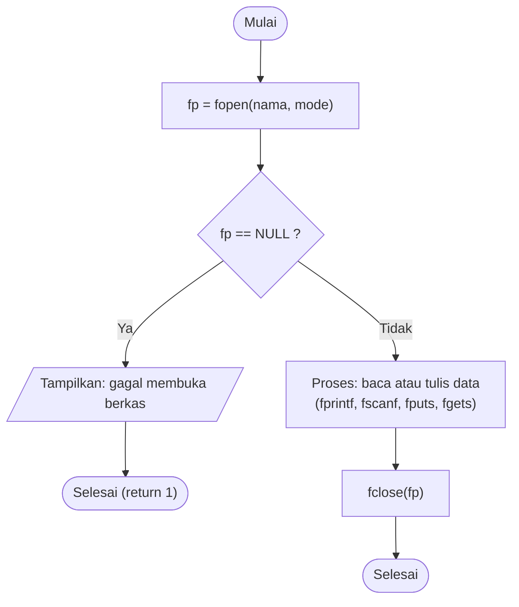
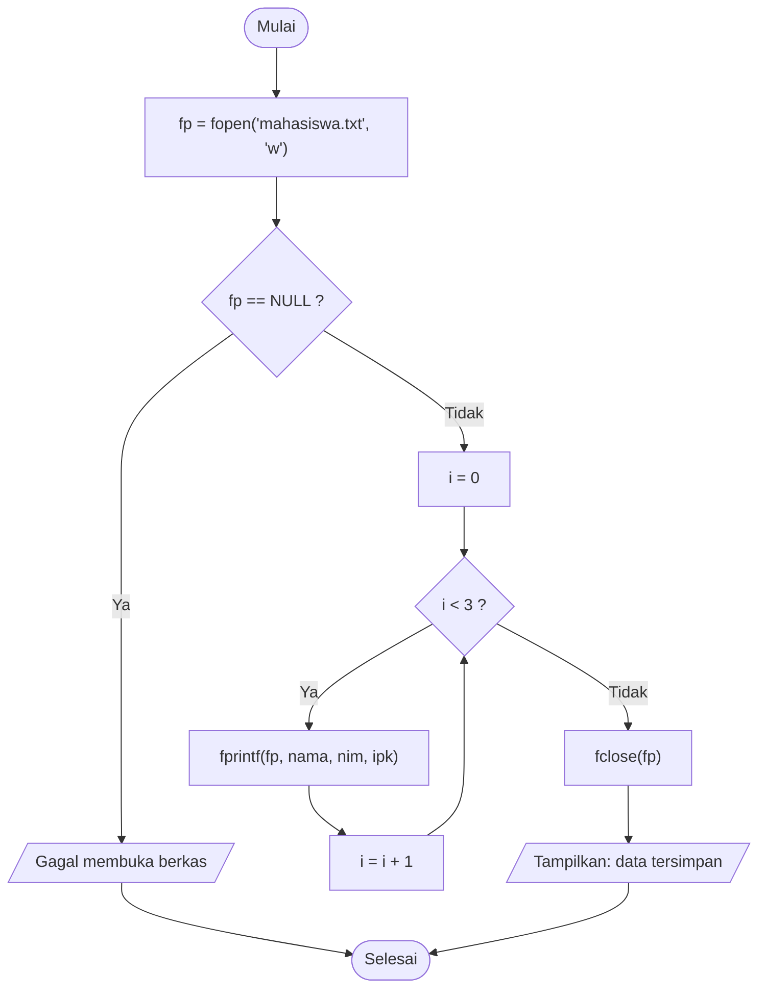
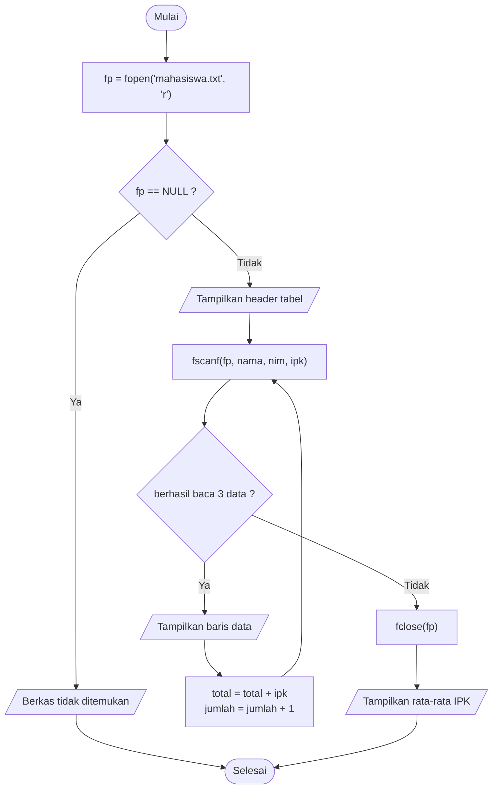
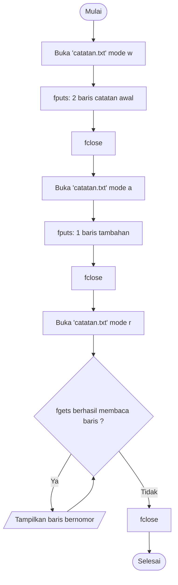
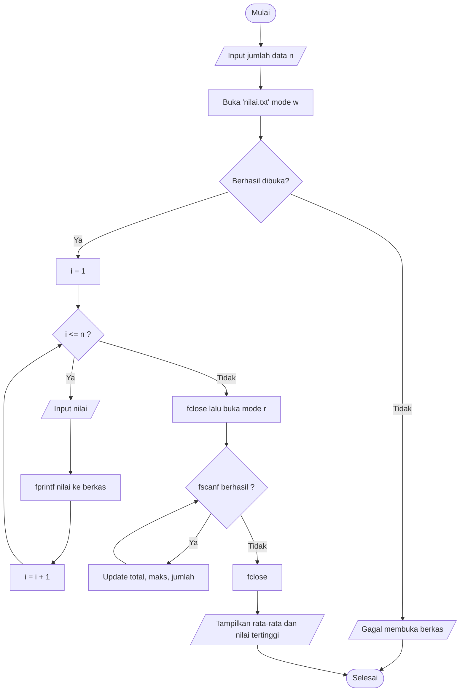

# 📂 Modul 7: Operasi Berkas (File Handling)
<!-- 
## Daftar Isi
1. [Mengapa Perlu Berkas?](#1-mengapa-perlu-berkas)
2. [Membuka dan Menutup Berkas](#2-membuka-dan-menutup-berkas)
3. [Menulis dan Membaca Data Terformat](#3-data-terformat-fprintf-dan-fscanf)
4. [Menulis dan Membaca Baris Teks](#4-baris-teks-fputs-dan-fgets)
5. [Mini Proyek: Rekap Nilai](#5-mini-proyek-rekap-nilai)
6. [Latihan](#6-latihan)

--- -->

## 1. Mengapa Perlu Berkas?

Data di variabel/array hilang saat program berakhir (disimpan di RAM). **Berkas (file)** menyimpan data secara **permanen** di penyimpanan (harddisk/SSD).

```
   ┌────────────┐    fprintf / fputs     ┌──────────────┐
   │  PROGRAM   │ ─────────────────────► │  BERKAS      │
   │  (RAM)     │                        │  data.txt    │
   │ variabel   │ ◄───────────────────── │  (disk)      │
   └────────────┘    fscanf / fgets      └──────────────┘
      sementara                             permanen
```

Di C, berkas diakses lewat **pointer bertipe `FILE`**:

```c
FILE *fp;
```

---

## 2. Membuka dan Menutup Berkas

### 2.1 `fopen()` dan `fclose()`

```c
FILE *fp = fopen("nama_berkas.txt", "mode");
...
fclose(fp);
```

| Mode | Arti | Bila berkas belum ada | Bila berkas sudah ada |
|------|------|-----------------------|-----------------------|
| `"r"` | **Read** (baca) | ❌ Gagal, `fp == NULL` | Dibuka dari awal |
| `"w"` | **Write** (tulis) | ✅ Dibuat baru | ⚠️ Isi lama **dihapus** |
| `"a"` | **Append** (tambah) | ✅ Dibuat baru | Data baru ditambah di **akhir** |

> `fopen` mengembalikan `NULL` bila gagal. **Selalu periksa** sebelum dipakai. Selalu `fclose` setelah selesai agar data benar-benar tersimpan.

### 2.2 Siklus Kerja Berkas



### 2.3 Fungsi-fungsi Baca/Tulis

| Fungsi | Kegunaan | Mirip dengan |
|--------|----------|--------------|
| `fprintf(fp, "format", ...)` | Tulis data **terformat** | `printf` |
| `fscanf(fp, "format", &...)` | Baca data **terformat** | `scanf` |
| `fputs("teks", fp)` | Tulis **satu baris/teks** | `puts` |
| `fgets(buf, ukuran, fp)` | Baca **satu baris teks** | `gets` (versi aman) |

---

## 3. Data Terformat: `fprintf` dan `fscanf`

### 3.1 Program 7.1: Menulis Data Mahasiswa ke Berkas

#### Flowchart



#### Kode

```c
#include <stdio.h>

int main() {
    char  nama[3][20] = {"Ani", "Budi", "Citra"};
    int   nim[3]      = {2024001, 2024002, 2024003};
    float ipk[3]      = {3.75f, 3.40f, 3.90f};

    FILE *fp = fopen("mahasiswa.txt", "w");
    if (fp == NULL) {
        printf("Gagal membuka berkas!\n");
        return 1;
    }

    for (int i = 0; i < 3; i++) {
        fprintf(fp, "%s %d %.2f\n", nama[i], nim[i], ipk[i]);
    }

    fclose(fp);
    printf("Data berhasil disimpan ke mahasiswa.txt\n");
    return 0;
}
```

**Hasil (Output di layar):**

```
Data berhasil disimpan ke mahasiswa.txt
```

**Isi berkas `mahasiswa.txt` yang terbentuk:**

```
Ani 2024001 3.75
Budi 2024002 3.40
Citra 2024003 3.90
```

### 3.2 Program 7.2: Membaca Data dari Berkas

`fscanf` mengembalikan **jumlah data yang berhasil dibaca**. Perulangan berhenti saat hasilnya bukan 3 (akhir berkas).

#### Flowchart



#### Kode

```c
#include <stdio.h>

int main() {
    char  nama[20];
    int   nim, jumlah = 0;
    float ipk, total = 0;

    FILE *fp = fopen("mahasiswa.txt", "r");
    if (fp == NULL) {
        printf("Berkas tidak ditemukan!\n");
        return 1;
    }

    printf("%-8s %-10s %s\n", "Nama", "NIM", "IPK");
    printf("-----------------------------\n");

    while (fscanf(fp, "%s %d %f", nama, &nim, &ipk) == 3) {
        printf("%-8s %-10d %.2f\n", nama, nim, ipk);
        total += ipk;
        jumlah++;
    }
    fclose(fp);

    if (jumlah > 0) {
        printf("\nJumlah data   : %d\n", jumlah);
        printf("Rata-rata IPK : %.2f\n", total / jumlah);
    }
    return 0;
}
```

**Hasil (Output):**

```
Nama     NIM        IPK
-----------------------------
Ani      2024001    3.75
Budi     2024002    3.40
Citra    2024003    3.90

Jumlah data   : 3
Rata-rata IPK : 3.68
```

> Rata-rata = (3.75 + 3.40 + 3.90) / 3 = 3.683 → ditampilkan `3.68`.

**Bila berkas belum ada** (misal jalankan Program 7.2 sebelum 7.1):

```
Berkas tidak ditemukan!
```

---

## 4. Baris Teks: `fputs` dan `fgets`

`fgets` membaca **satu baris penuh** (termasuk spasi) hingga `\n` atau batas ukuran buffer. Cocok untuk catatan/teks bebas.

### 4.1 Mode Tulis (`"w"`) vs Tambah (`"a"`)

```
   Mode "w" (write)                        Mode "a" (append)

   Sebelum: [ baris lama 1 ]               Sebelum: [ baris lama 1 ]
            [ baris lama 2 ]                        [ baris lama 2 ]
   Aksi   : fopen(..., "w") → isi dihapus  Aksi   : fopen(..., "a") → isi dipertahankan
   Sesudah: [ baris baru   ]               Sesudah: [ baris lama 1 ]
                                                    [ baris lama 2 ]
                                                    [ baris baru   ]
```

### 4.2 Flowchart: Tulis, Tambah, lalu Baca Catatan



### 4.3 Program 7.3: `fputs`, `fgets`, dan Mode Append

```c
#include <stdio.h>

int main() {
    FILE *fp;
    char baris[100];
    int nomor = 1;

    // 1) Tulis (mode "w")
    fp = fopen("catatan.txt", "w");
    if (fp == NULL) { printf("Gagal membuka berkas!\n"); return 1; }
    fputs("Belajar bahasa C itu menyenangkan.\n", fp);
    fputs("Hari ini mempelajari file handling.\n", fp);
    fclose(fp);

    // 2) Tambah (mode "a")
    fp = fopen("catatan.txt", "a");
    if (fp == NULL) { printf("Gagal membuka berkas!\n"); return 1; }
    fputs("Besok latihan soal.\n", fp);
    fclose(fp);

    // 3) Baca (mode "r")
    fp = fopen("catatan.txt", "r");
    if (fp == NULL) { printf("Gagal membuka berkas!\n"); return 1; }

    printf("Isi catatan.txt:\n");
    while (fgets(baris, sizeof(baris), fp) != NULL) {
        printf("%d. %s", nomor++, baris);     // baris sudah memuat \n
    }
    fclose(fp);
    return 0;
}
```

**Hasil (Output):**

```
Isi catatan.txt:
1. Belajar bahasa C itu menyenangkan.
2. Hari ini mempelajari file handling.
3. Besok latihan soal.
```

---

## 5. Mini Proyek: Rekap Nilai

Program menerima beberapa nilai dari pengguna, menyimpannya ke `nilai.txt`, lalu membaca kembali untuk menghitung rata-rata dan nilai tertinggi.

### 5.1 Flowchart



### 5.2 Kode

```c
#include <stdio.h>

int main() {
    int n, nilai;
    FILE *fp;

    printf("Jumlah nilai yang akan disimpan: ");
    scanf("%d", &n);

    // Tulis nilai ke berkas
    fp = fopen("nilai.txt", "w");
    if (fp == NULL) { printf("Gagal membuka berkas!\n"); return 1; }
    for (int i = 1; i <= n; i++) {
        printf("Nilai ke-%d: ", i);
        scanf("%d", &nilai);
        fprintf(fp, "%d\n", nilai);
    }
    fclose(fp);

    // Baca kembali dan hitung statistik
    fp = fopen("nilai.txt", "r");
    if (fp == NULL) { printf("Gagal membuka berkas!\n"); return 1; }

    int jumlah = 0, total = 0, maks = 0;
    while (fscanf(fp, "%d", &nilai) == 1) {
        total += nilai;
        if (jumlah == 0 || nilai > maks) maks = nilai;
        jumlah++;
    }
    fclose(fp);

    if (jumlah > 0) {
        printf("\n--- Rekap dari nilai.txt ---\n");
        printf("Banyak data : %d\n", jumlah);
        printf("Rata-rata   : %.2f\n", (float)total / jumlah);
        printf("Tertinggi   : %d\n", maks);
    }
    return 0;
}
```

**Hasil (Output)** (masukan `4`, lalu `80`, `65`, `90`, `75`):

```
Jumlah nilai yang akan disimpan: 4
Nilai ke-1: 80
Nilai ke-2: 65
Nilai ke-3: 90
Nilai ke-4: 75

--- Rekap dari nilai.txt ---
Banyak data : 4
Rata-rata   : 77.50
Tertinggi   : 90
```

**Isi berkas `nilai.txt`:**

```
80
65
90
75
```

---

## 6. Latihan

1. Buat program yang menyimpan **nama dan nomor telepon** 3 kontak ke berkas, lalu membacanya kembali.
2. Buat program yang **menghitung jumlah baris** dalam sebuah berkas teks memakai `fgets`.
3. Buat program yang menyalin isi `a.txt` ke `b.txt` baris demi baris.
4. Modifikasi Program 7.1 agar memakai mode `"a"` sehingga data lama tidak terhapus. Jalankan dua kali dan amati isi berkas.
5. Gabungkan dengan Modul 4: simpan dan baca `struct Mahasiswa` ke/dari berkas.

### ❗ Kesalahan Umum

| Kesalahan | Akibat | Perbaikan |
|-----------|--------|-----------|
| Tidak mengecek `fp == NULL` | Program crash bila berkas tak ada | Selalu periksa hasil `fopen` |
| Lupa `fclose()` | Data mungkin tidak tersimpan penuh | Tutup berkas setelah selesai |
| Memakai `"w"` padahal ingin menambah | Data lama hilang | Gunakan `"a"` |
| Format `fscanf` tidak sesuai isi berkas | Pembacaan berhenti / data salah | Samakan format dengan cara menulis |
| Membaca berkas dengan mode `"w"` | Isi berkas terhapus | Gunakan `"r"` |

---

## 🎓 Penutup

Anda telah menyelesaikan 7 modul dasar: **sintaks → alur kontrol → fungsi → struktur data → pointer → algoritma → berkas**. Langkah lanjutan yang disarankan: *linked list, stack, queue, tree*, algoritma $O(n \log n)$ (merge sort, quick sort), dan pemrograman modular multi-file.

⬅️ [Modul 6](Modul-6-Contoh-Implentasi-Algoritma-Dasar.md) | 🏠 [Daftar Isi](/bahasa-c/Modul-0-Algoritma-Flowchart-Pseudocode)
